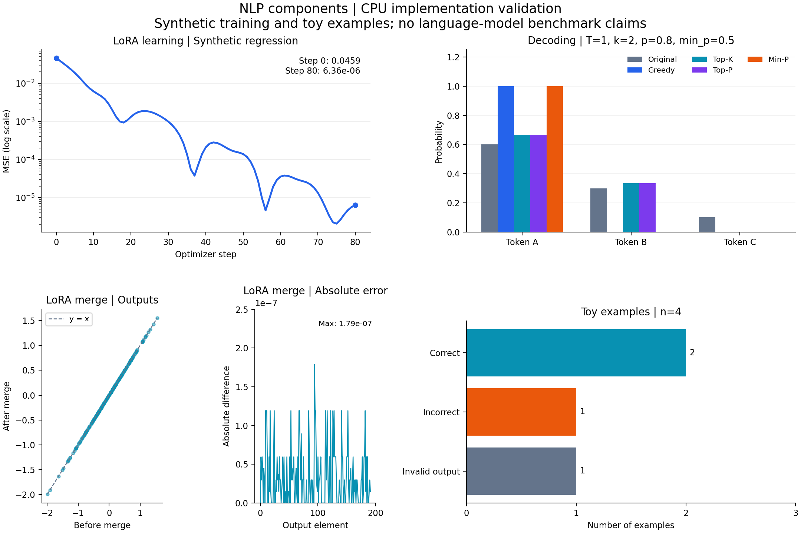
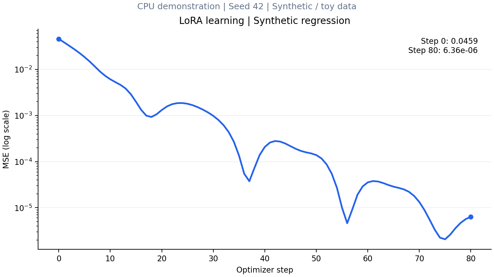
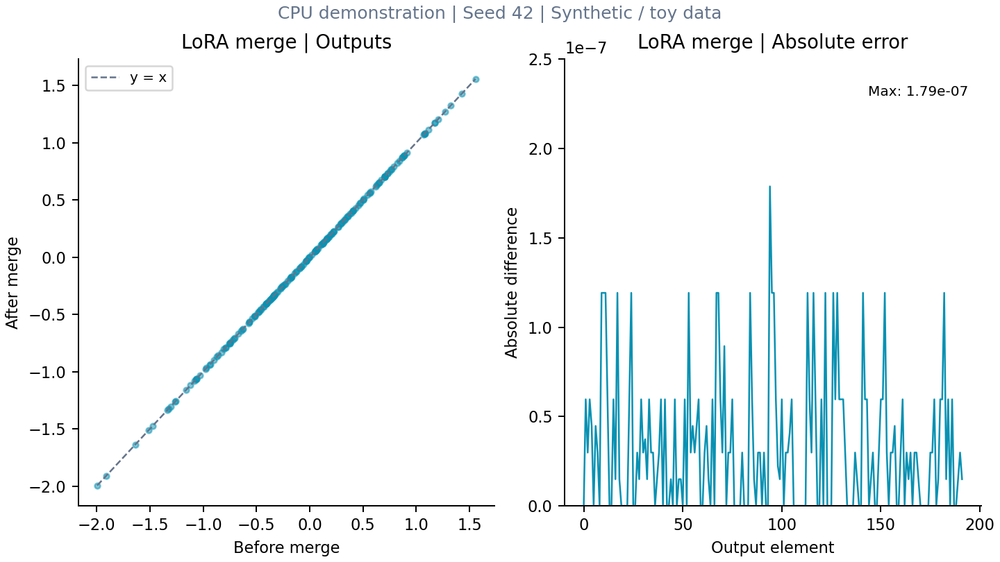
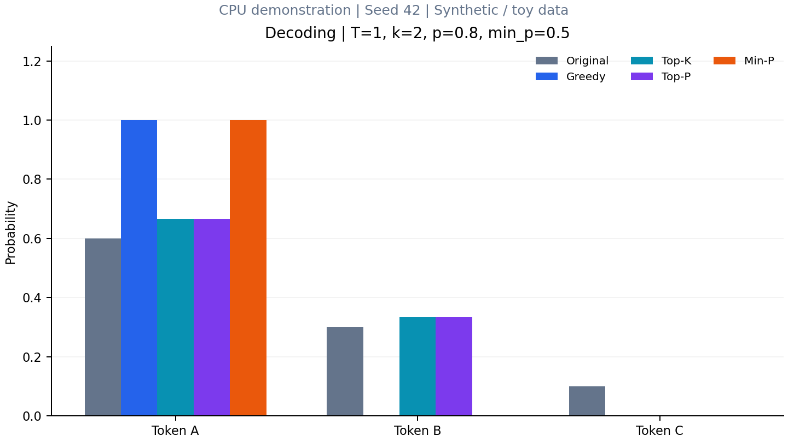
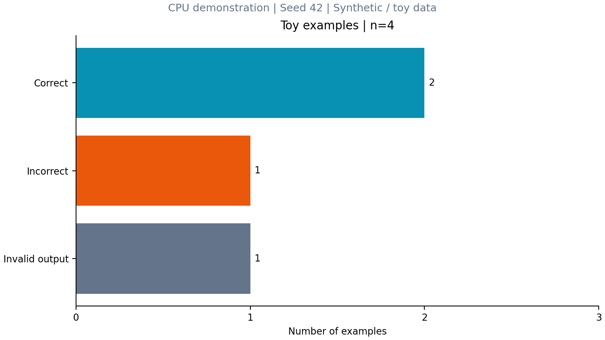
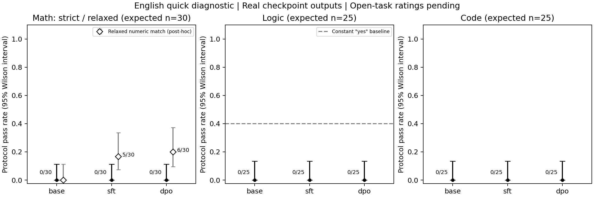

# NLP Course Implementations

**Explore Transformer attention, LoRA adapters, decoding strategies, and answer evaluation through small, testable PyTorch implementations.**

[](https://github.com/LAnthonyJ/-nlp-/actions/workflows/tests.yml)

[中文](README.zh-CN.md) · [Quick start](#quick-start) · [Examples](#try-the-components) · [Results](#verified-results) · [API guide](docs/api.md)

Built for students and developers who want to read the implementation, run it on a CPU, and check why it works. The included examples use tiny tensors and synthetic data; once PyTorch is installed, they run without downloading models or datasets.



Measured single-seed CPU demonstrations: learning, merge consistency, candidate distributions and four toy examples. These show implementation behavior. See [source reports](docs/validation/visualization/) and [reproduction steps](docs/visualization.md).

## What you can explore

| Component | Implementation | What you can verify |
| --- | --- | --- |
| Transformer | [Embeddings, attention, encoder and decoder](src/nlp_course/transformer.py) | Independent layer weights, causal and padding masks, feature-wise normalization, forward/backward passes |
| LoRA | [Low-rank adapters and projection injection](src/nlp_course/lora.py) | Zero initial update, frozen base weights, adapter gradients, equivalent outputs after merging |
| Decoding | [Greedy, Top-K, Top-P and relative Min-P](src/nlp_course/decoding.py) | Candidate probabilities, temperature, repetition penalty, EOS stopping |
| Evaluation | [Offline JSONL scoring and batched backend interface](src/nlp_course/evaluation.py) | Exact numeric comparisons, invalid-answer records, complete batch coverage |

Start with [`examples/cpu_demo.py`](examples/cpu_demo.py) for an end-to-end demonstration, then explore the [regression tests](tests/) for the invariants behind each component.

The [local training guide](docs/training.md) documents completion-only SFT, verified preference data, checkpoint selection, and configurable real-model evaluation.

The [repair evaluation](docs/repair-results/README.md) contains 525 fresh responses. On the same held-out subsets, original SFT to repaired SFT code passes increase from 0/25 to 7/25; math final numeric matches increase from 9/30 to 10/30, with strict-format passes increasing from 0/30 to 10/30. Logic remains at an always-yes baseline. DPO did not improve the development objective mean.

On 60 paired reasoning tasks, continued SFT solved four pairs and DPO trained on the same prompts and observed errors solved zero. All four models, individual predictions and training curves are in the [paired DPO experiment](docs/paired-dpo-results/README.md).

## Quick start

Requires Git and Python. The package declares Python 3.10+; verified environments are **Linux / Python 3.11** in CI and **Windows / Python 3.13.7**, with PyTorch 2.9.0+cpu.

```sh
git clone https://github.com/LAnthonyJ/-nlp-.git nlp-course-implementations
cd nlp-course-implementations
python -m venv .venv
```

Activate the environment:

| Platform | Command |
| --- | --- |
| Windows PowerShell | `.\.venv\Scripts\Activate.ps1` |
| Linux | `source .venv/bin/activate` |

Install the CPU dependency and the local package, then run the demo:

```sh
python -m pip install -r requirements-cpu.txt --index-url https://download.pytorch.org/whl/cpu
python -m pip install --no-deps -e .
python examples/cpu_demo.py
```

Already cloned? Start from the environment setup in your existing repository. If PowerShell activation is unavailable, use `.\.venv\Scripts\python.exe` in place of `python`. For macOS or another PyTorch build, install the build appropriate for your platform before installing this package; those configurations have not been verified here.

## Try the components

### Run a tiny training example

```sh
python examples/cpu_demo.py
```

The demo runs a Transformer forward/backward pass, optimizes a LoRA adapter for 80 steps on a synthetic regression task, checks merge equivalence, and prints decoding distributions plus toy evaluation records. Selected fields from the [recorded output](docs/validation/cpu-demo.json):

```json
{
  "seed": 42,
  "device": "cpu",
  "transformer_shape": [2, 5, 16],
  "lora_synthetic_loss_before": 0.04594896361231804,
  "lora_synthetic_loss_after": 0.000006364347882481525,
  "lora_merge_max_error": 0.00000017881393432617188
}
```



All 81 measured points, steps 0–80, on a log MSE axis without smoothing. Oscillations are part of the actual run.



Compare the same 192 output elements before/after merging and their absolute differences. [Measured traces](docs/validation/visualization/cpu-demo.json).

### Inspect a decoding distribution

After installation, run this in Python to see how relative Min-P filters and renormalizes three candidate tokens:

```python
import torch
from nlp_course.decoding import DecodingSampler

logits = torch.tensor([0.6, 0.3, 0.1]).log()
probs = DecodingSampler().distribution(logits, strategy="minp", min_p=0.4)
print([round(p, 3) for p in probs.tolist()])
# [0.667, 0.333, 0.0]
```

Relative Min-P retains tokens with probability at least `min_p * max_probability`. Switch `strategy` to `greedy`, `topk`, or `topp` to explore other filters; see the [parameter and generation guide](docs/api.md#decoding).



Three fixed candidate tokens, original probabilities and four strategies; settings are shown in the title. Min-P boundary inclusion follows the actual floating-point probabilities.

### Score saved answers

```sh
python -m nlp_course.evaluation examples/toy_predictions.jsonl --output outputs/toy-report.json
```

Each input line contains `prediction` and `reference` strings. The [four-example fixture](examples/toy_predictions.jsonl) deliberately includes a wrong answer and an invalid output. Its [report](docs/validation/toy-evaluation.json) contains `total: 4`, `correct: 2`, `invalid_outputs: 1`, and per-example records.

> [!NOTE]
> These are synthetic demonstrations, not pretrained-model benchmark results. `gsm8k` mode compares supported numeric answers exactly, without rounding. `math-strict` performs supported numeric or stripped-text matching; it does not implement general symbolic equivalence or official MATH scoring. See [answer formats and scoring limits](docs/api.md#evaluation).



Counts only the four-example fixture: 2 correct, 1 incorrect, 1 invalid. The CPU demo's separate two examples are excluded. [Per-example records](docs/validation/visualization/toy-evaluation.json).

## Real-checkpoint capability diagnosis

Completed **420 real-checkpoint responses** across Base, SFT and DPO: 100 main tasks plus 20 controlled probe pairs per stage. Read the [measured results and capability boundaries](docs/capability-results/README.md), [auditable statistics](docs/capability-results/analysis.json) and [evaluation workflow](docs/capability-evaluation.md).



Strict protocol success was zero on the selected math/logic/code tasks. Secondary, post-hoc math matching found 5/30 SFT and 6/30 DPO answers numerically correct. This one-item difference does not establish an overall DPO advantage. Concept/writing quality remains pending anonymous human ratings. See the report for format failures, code failures, the imbalanced logic baseline and controlled-probe limitations. These checkpoint results are separate from the synthetic CPU demonstrations above.

## Verified results

Run the regression suite with the Python standard library:

```sh
python -m unittest discover -s tests -v
```

The [CI workflow](.github/workflows/tests.yml) builds and installs the package, runs the suite, and executes both offline examples across **Linux / Python 3.10–3.13** and **Windows / Python 3.13**. Each job saves its environment, test log and JSON results as a downloadable artifact. See [CI coverage and reports](docs/ci.md).

| Check | Recorded result |
| --- | --- |
| Regression suite | Includes checks for paired task isolation, preference provenance, frozen reference scores and published outcome counts |
| Transformer output | `[2, 5, 16]`, with finite gradients |
| Synthetic LoRA optimization | MSE `0.045949` → `0.000006364` after 80 steps, seed 42 |
| LoRA merge consistency | Maximum absolute output difference ≈ `1.79e-7` |
| First published version | [GitHub Actions passed](https://github.com/LAnthonyJ/-nlp-/actions/runs/43263272641) |

These values describe the recorded CPU run; small numeric differences may occur across environments. See [validation details](docs/validation.md) and [raw results](docs/validation/) for the environment and execution evidence.

## Explore the repository

```text
src/nlp_course/       Reusable implementations used by the examples and tests
coursework/          Five original coursework snapshots, preserved byte-for-byte
examples/            CPU demonstration and toy evaluation data
tests/               Regression tests for correctness and edge cases
docs/                API, source review, provenance and recorded validation
.github/workflows/   Automated CPU checks
```

Use `src/nlp_course/` for runnable components. The historical `coursework/` files retain the issues discussed in the [source review](docs/code-review.md). The [API guide](docs/api.md) explains mask conventions, inference-only LoRA merging, and changes from the originals.

The five original coursework implementations were completed by the repository owner. Repository preparation, repairs, tests and documentation were developed with AI assistance; see [provenance and contribution details](docs/provenance.md).
