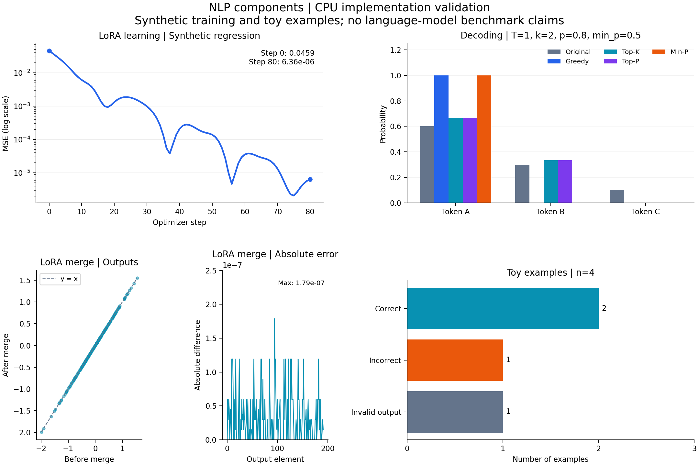
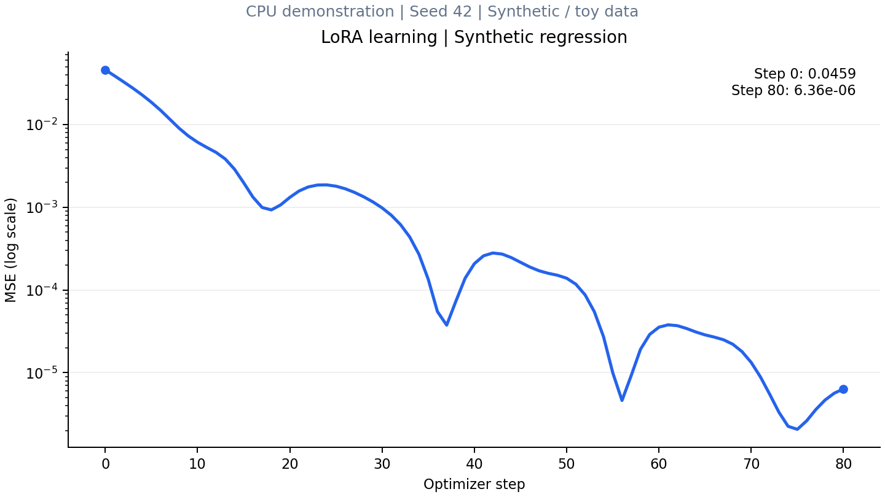
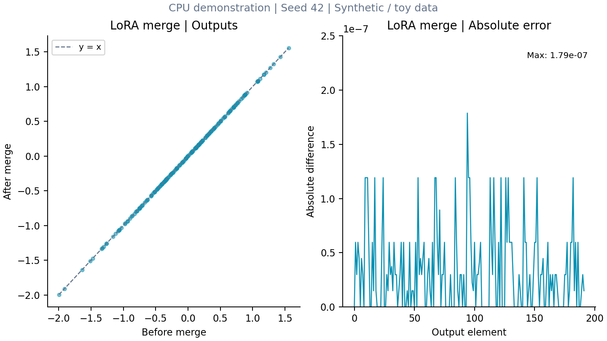
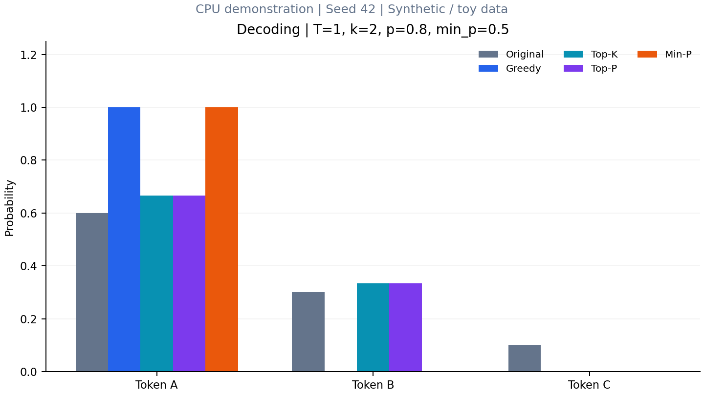
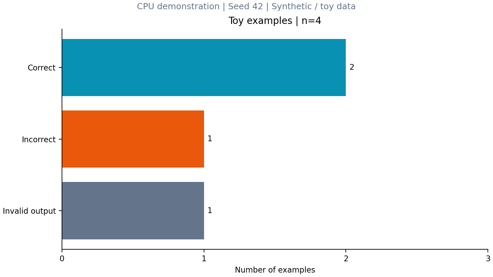
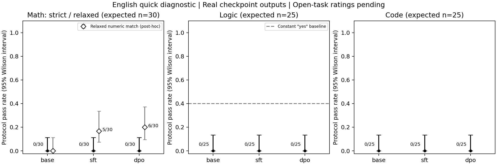

# NLP 课程代码实现

**通过可阅读、可测试的 PyTorch 实现，理解 Transformer、LoRA、解码策略和答案评测。**

[](https://github.com/LAnthonyJ/-nlp-/actions/workflows/tests.yml)

[English](README.md) · [快速开始](#快速开始) · [运行示例](#运行示例) · [验证结果](#验证结果) · [接口说明](docs/api.md)

本项目适合希望理解 NLP 实现细节、通过小例子检查算法行为的学习者。安装 PyTorch 后，内置示例可以在 CPU 上运行，无需下载模型或数据集。



单次固定种子的 CPU 示例：学习曲线、合并一致性、候选概率和四条玩具评测。此图展示实现验证；[原始数据](docs/validation/visualization/)与[重新生成步骤](docs/visualization.md)可供检查。

## 可以探索什么

| 模块 | 代码入口 | 可以验证的行为 |
| --- | --- | --- |
| Transformer | [嵌入、注意力、编码器与解码器](src/nlp_course/transformer.py) | 层参数独立、因果与填充掩码、归一化、前向和反向传播 |
| LoRA | [低秩适配与模块注入](src/nlp_course/lora.py) | 初始增量为零、基础参数冻结、适配器梯度、合并前后输出一致 |
| 解码 | [Greedy、Top-K、Top-P、相对 Min-P](src/nlp_course/decoding.py) | 候选词概率、温度、重复惩罚、EOS 停止 |
| 评测 | [离线 JSONL 评分与批量生成接口](src/nlp_course/evaluation.py) | 精确数值比较、无效答案统计、批次完整性 |

建议从 [`examples/cpu_demo.py`](examples/cpu_demo.py) 开始，再结合[回归测试](tests/)理解各组件的正确性条件。

[本地训练指南](docs/training.md)涵盖仅对回答计算损失的 SFT、可验证偏好数据、开发集选模与可配置的真实模型复评。

[本轮修复复评](docs/repair-results/README.zh-CN.md)包含 525 条新回答。同一保留集上，旧 SFT 到新 SFT 的代码测试通过从 0/25 到 7/25；数学最终数值匹配从 9/30 到 10/30，严格格式得分从 0/30 到 10/30。逻辑仍等于恒答 yes 基线，DPO 未提升开发集客观均分。

在 60 组成对推理题上，继续 SFT 答对 4 组，使用相同提示和真实错答的 DPO 答对 0 组。四组对照、逐题输出与训练曲线见[成对推理 DPO 实验](docs/paired-dpo-results/README.zh-CN.md)。

[SmolLM2 公开评测](docs/smollm2-results/README.zh-CN.md)比较六组 Qwen 权重的 PIQA、HellaSwag 成绩和五组指令模型的 IFEval 成绩，包含官方基线校准、逐题预测及 DPO 相对继续 SFT 的配对差值区间。

在[一次 SFT、一次 DPO 的重训实验](docs/progression-results/README.zh-CN.md)中，Qwen2.5-0.5B 在四任务封存题上的等权综合分依次为 37.04%、41.58%、42.66%。提升主要来自 GSM8K，严格指令遵循得分有所下降。报告同时列出首轮失败原因和锁定权重后的全量公开评测。

## 快速开始

需要 Git 和 Python。项目声明 Python 3.10+；已验证 **Linux / Python 3.11** 和 **Windows / Python 3.13.7**，使用 PyTorch 2.9.0+cpu。

```sh
git clone https://github.com/LAnthonyJ/-nlp-.git nlp-course-implementations
cd nlp-course-implementations
python -m venv .venv
```

根据系统激活虚拟环境：

| 系统 | 命令 |
| --- | --- |
| Windows PowerShell | `.\.venv\Scripts\Activate.ps1` |
| Linux | `source .venv/bin/activate` |

安装 CPU 依赖和本地包，然后运行：

```sh
python -m pip install -r requirements-cpu.txt --index-url https://download.pytorch.org/whl/cpu
python -m pip install --no-deps -e .
python examples/cpu_demo.py
```

如果已经有本地仓库，直接在现有目录配置环境即可。PowerShell 无法激活时，可以用 `.\.venv\Scripts\python.exe` 替代命令中的 `python`。macOS 或其他 PyTorch 构建需先安装适配平台的版本；这些环境尚未在本项目验证。

## 运行示例

### 微型 Transformer 与 LoRA 优化

```sh
python examples/cpu_demo.py
```

示例会执行 Transformer 前向与反向传播，在合成回归数据上优化 LoRA 适配器 80 步，检查合并一致性，并输出解码分布和玩具评测记录。[已记录输出](docs/validation/cpu-demo.json)中的部分字段：

```json
{
  "seed": 42,
  "device": "cpu",
  "transformer_shape": [2, 5, 16],
  "lora_synthetic_loss_before": 0.04594896361231804,
  "lora_synthetic_loss_after": 0.000006364347882481525,
  "lora_merge_max_error": 0.00000017881393432617188
}
```



第 0–80 步的实测 MSE，共 81 点；对数纵轴，未平滑。图中起伏反映实际训练过程。



同一输入的 192 个输出元素，比较合并前后数值和逐元素绝对误差。[补录报告](docs/validation/visualization/cpu-demo.json)。

### 查看解码候选概率

安装完成后，在 Python 中运行以下代码，观察相对 Min-P 如何筛选三个候选 token 并重新归一化：

```python
import torch
from nlp_course.decoding import DecodingSampler

logits = torch.tensor([0.6, 0.3, 0.1]).log()
probs = DecodingSampler().distribution(logits, strategy="minp", min_p=0.4)
print([round(p, 3) for p in probs.tolist()])
# [0.667, 0.333, 0.0]
```

相对 Min-P 保留满足 `概率 >= min_p × 最大概率` 的候选。还可以切换为 `greedy`、`topk`、`topp`，具体参数见[解码接口](docs/api.md#decoding)。



固定三个候选 token，对比原始分布和四种策略，具体参数见图标题。Min-P 阈值附近的候选是否被保留取决于实际浮点概率。

### 评测已保存的答案

```sh
python -m nlp_course.evaluation examples/toy_predictions.jsonl --output outputs/toy-report.json
```

每行输入包含字符串字段 `prediction` 和 `reference`。[示例数据](examples/toy_predictions.jsonl)共有四条，刻意包含错误答案与无效输出；[评分报告](docs/validation/toy-evaluation.json)统计为：总数 4、正确 2、无效输出 1，并保留逐条记录。

> [!NOTE]
> 上述结果来自合成示例，不代表预训练模型基准成绩。`gsm8k` 模式对受支持的数值进行精确比较，不取整；`math-strict` 只比较受支持的数值或去除首尾格式后的文本，不提供通用符号判等，也不是官方 MATH 评分。详见[答案格式与评分范围](docs/api.md#evaluation)。



此图仅统计四条独立示例：正确 2、错误 1、无法提取 1；未混入 CPU 示例内嵌的两条记录。[逐条案例](docs/validation/visualization/toy-evaluation.json)。

## 真实模型能力诊断

已完成 Base、SFT、DPO 共 **420 条真实权重回答**：每阶段 100 道主题题目，加 20 组受控题对。查看[实测结果与能力边界](docs/capability-results/README.zh-CN.md)、[可核查统计](docs/capability-results/analysis.json)与[评测流程](docs/capability-evaluation.md)。



本轮数学、逻辑、代码的严格协议成功率均为零；事后补充的数学数值匹配为 SFT 5/30、DPO 6/30，一题差异不能证明 DPO 整体更好。概念与写作质量仍待匿名人工评分。报告区分格式失败、代码失败、逻辑集答案偏置及受控探针限制；这些真实权重结果与上方合成 CPU 实现验证分开统计。

## 验证结果

使用 Python 标准库运行回归测试：

```sh
python -m unittest discover -s tests -v
```

[自动测试流程](.github/workflows/tests.yml)覆盖 **Linux / Python 3.10–3.13** 和 **Windows / Python 3.13**，构建并安装包、运行测试与两条离线示例命令。每组环境都会保存环境信息、测试日志与 JSON 结果，可在 Actions 页面下载。详见 [CI 验证范围与报告](docs/ci.md)。

| 检查项 | 已记录结果 |
| --- | --- |
| 回归测试 | 覆盖题组划分、真实错答来源、参考分数冻结及公开结果与逐题记录的一致性 |
| Transformer 输出 | `[2, 5, 16]`，梯度有限 |
| 合成数据上的 LoRA 优化 | 80 步后 MSE 从 `0.045949` 降至 `0.000006364`，种子 42 |
| LoRA 合并一致性 | 最大绝对输出差约 `1.79e-7` |
| 首次公开版本 | [GitHub Actions 通过](https://github.com/LAnthonyJ/-nlp-/actions/runs/43263272641) |

以上为已记录的 CPU 运行结果，不同环境可能产生小幅数值差异。环境和执行证据见[验证记录](docs/validation.md)与[原始结果](docs/validation/)。

## 仓库导航

```text
src/nlp_course/       示例和测试使用的可复用实现
coursework/          五份原始课程代码，逐字节保留
examples/            CPU 示例与玩具评测数据
tests/               正确性与边界情况回归测试
docs/                接口、审查、来源和验证记录
.github/workflows/   自动化 CPU 检查
```

请使用 `src/nlp_course/` 中的实现。`coursework/` 是保留已知问题的历史版本，详见[源码审查](docs/code-review.md)。[接口说明](docs/api.md)进一步介绍掩码约定、LoRA 推理合并及版本差异。

五份原始课程实现由仓库作者完成；仓库整理、修复、测试与文档由 AI 辅助完成，详见[来源与贡献说明](docs/provenance.md)。
