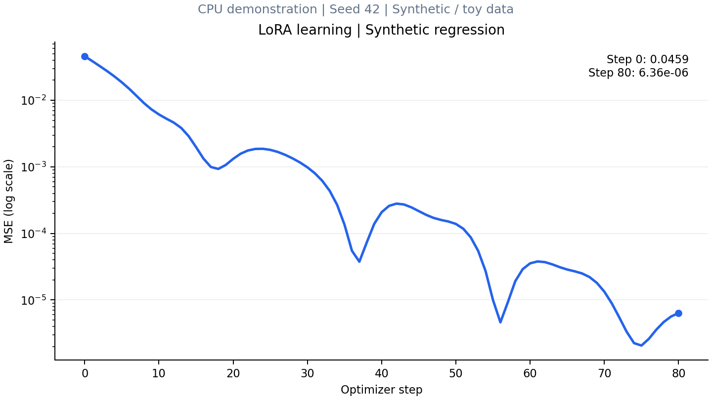
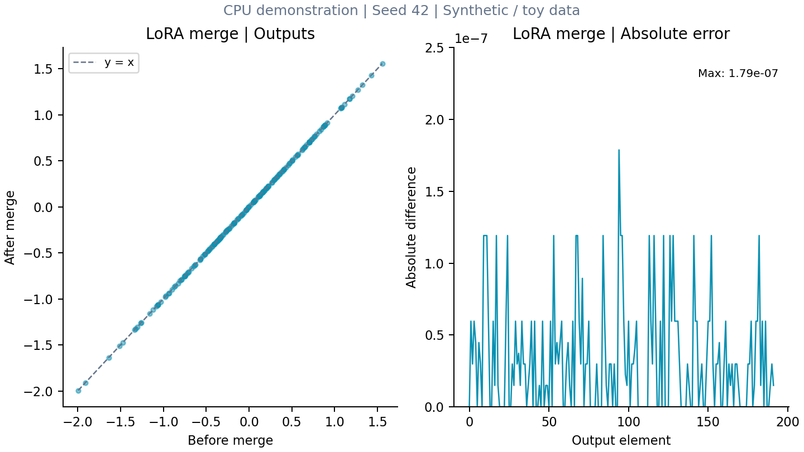
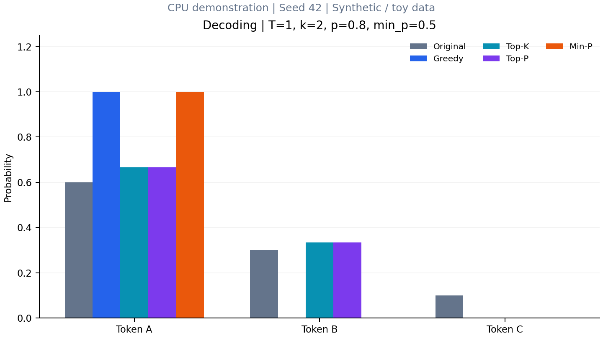
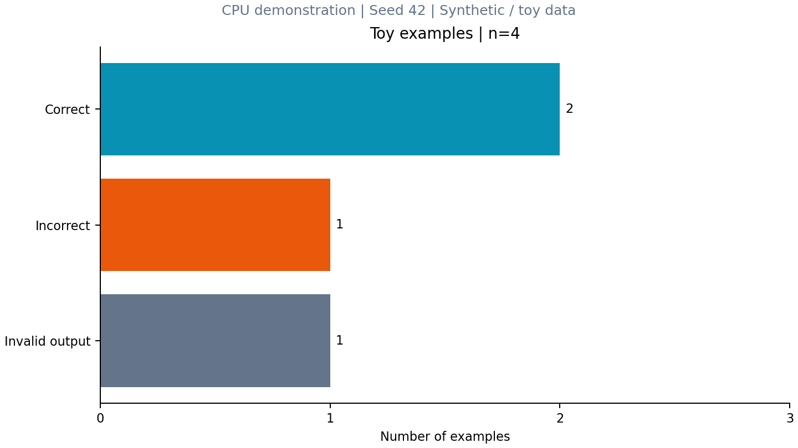
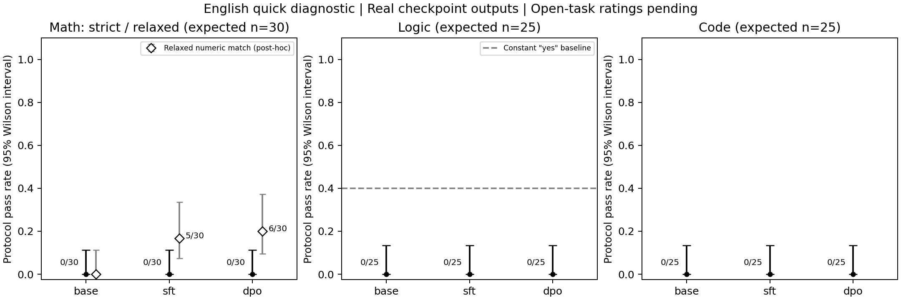

# Implementation guide and experiment notes

The [project overview](README.md) introduces the causal attention example and the latest DPO comparison. This guide covers the CPU implementation checks and historical experiments.

## CPU examples

The package requires Python 3.10 or later. The recorded runs used Linux with Python 3.11 and Windows with Python 3.13.7 and CPU PyTorch 2.9.0. Create an environment using the following commands.

```sh
git clone https://github.com/LAnthonyJ/language-model-for-education.git nlp-course-implementations
cd nlp-course-implementations
python -m venv .venv
```

On Windows, activate it with .\.venv\Scripts\Activate.ps1 or run the virtual environment's python.exe directly. On Linux, use source .venv/bin/activate. Install PyTorch for the target platform. The original checks covered the Linux and Windows builds.

```sh
python -m pip install -r requirements-cpu.txt --index-url https://download.pytorch.org/whl/cpu
python -m pip install --no-deps -e .
python examples/cpu_demo.py
```

The demo runs the Transformer forward and backward passes, optimizes a LoRA adapter on synthetic regression data for 80 steps, checks merged outputs, and prints decoding probabilities and toy scores. [Recorded outputs](docs/validation/cpu-demo.json)

```json
{
  "seed": 42,
  "device": "cpu",
  "transformer_shape": [2, 5, 16],
  "lora_synthetic_loss_before": 0.04594896361231804,
  "lora_synthetic_loss_after": 0.000006364347882481525,
  "lora_merge_max_error": 0.00000017881393432617188
}
```




## Decoding and scoring

Relative Min-P retains tokens with probability at least min_p times the maximum probability, then renormalizes. The other options are greedy, Top-K and Top-P. Floating-point precision can affect tokens at the threshold. [Decoding API](docs/api.md#decoding)

```python
import torch
from nlp_course.decoding import DecodingSampler

logits = torch.tensor([0.6, 0.3, 0.1]).log()
probs = DecodingSampler().distribution(logits, strategy="minp", min_p=0.4)
print([round(p, 3) for p in probs.tolist()])
# [0.667, 0.333, 0.0]
```



```sh
python -m nlp_course.evaluation examples/toy_predictions.jsonl --output outputs/toy-report.json
```

The four saved prediction/reference examples contain two correct answers, one incorrect answer and one answer that cannot be extracted. GSM8K mode compares supported numeric forms exactly. Math-strict accepts supported numbers and normalized text. Symbolic equivalence falls outside its scope. [Scoring API](docs/api.md#evaluation)



## Model experiments

The initial diagnostic collected 420 responses across Base, SFT and DPO. Each stage answered 100 main tasks and 20 pairs of controlled probes. All three stages scored zero on the strict mathematics, logic and code protocols. Relaxing the final-number format yielded 5/30 for SFT and 6/30 for DPO. Human scoring of concepts and writing remained pending. [Protocol](docs/capability-evaluation.md) · [Results](docs/capability-results/README.md)



Follow the subsequent [model repair](docs/repair-results/README.md), [paired training](docs/paired-dpo-results/REPORT.md), [public benchmark](docs/smollm2-results/README.md), [training progression](docs/progression-results/REPORT.md), [tokenizer repair](docs/progression-v2-results/README.md) and [hard-pair experiment](docs/hard-pairs-v3-results/README.md). The final hard-pair run improved 0.91 percentage points on 768 holdout questions and 0.15 points on the public benchmark. The prespecified one-point threshold was not met.

## Verification

```sh
python -m unittest discover -s tests -v
```

The tests cover causal and padding masks, independent Transformer parameters, frozen LoRA base parameters and adapter gradients, merge equivalence, sampling, evaluation, template separation and reference scores. Source and dataset provenance are recorded in the [manifest](docs/source-manifest.json).
