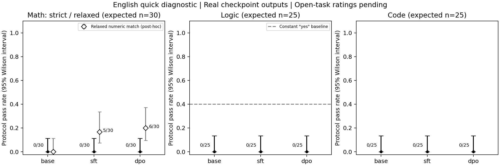
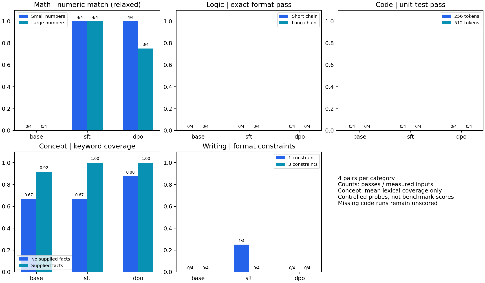

# 真实模型能力与边界：首轮诊断

[English](README.md) · [评测流程与人工评分规则](../capability-evaluation.md) · [逐题评分](scores.json) · [数据与权重清单](manifest.json)

2026-11-15，使用已有 Qwen2.5-0.5B、SFT 和 DPO 课程权重，完成 **420 条正式回答**。本轮测量的是固定英文指令接口下的任务完成情况。严格输出协议的成功率很低；补充分析发现部分数学回答的数值正确，但答案格式不符合要求。**概念与写作质量仍待人工评分**，目前不能宣称 DPO 整体优于 SFT。

## 实验范围

每阶段有 100 道主题评测题：数学 30、逻辑 25、代码 25、概念 10、写作 10；另有 20 组受控题对，共 40 个输入。三阶段共 300 条主题回答和 120 条诊断回答。受控题对有意复用问题以比较条件，不算额外的独立基准题。另做了每阶段 10 条开发检查，不纳入正式成绩。

采用单次固定种子 42、FP16、greedy、batch size 1、统一 user/assistant ChatML、通常 256 个输出 token；代码预算探针另用 512。SFT 与最终 DPO 适配器分别加载到 Base，未叠加，也未重新训练。GPU 为 RTX 3060 Laptop 6GB。模型、数据、配置与原始记录的哈希见[清单](manifest.json)。

数学题从 [GSM8K 官方测试集](https://github.com/openai/grade-school-math)抽样，代码从 [HumanEval](https://github.com/openai/human-eval)抽样；其余为本项目构造的窄范围任务。所用本地 GSM8K 转换文件与全部 1,319 条官方问答逐条一致，见[来源核验](official-data-check.json)。[题目索引](suite-index.json)保留抽样 ID 与提示哈希。

## 主题评测结果



黑点为严格协议成功率，菱形为事后补充的数学数值匹配率，误差线为 95% Wilson 区间。区间依赖二项抽样假设；模板题存在相似性，不能据此推断通用能力。零通过也不代表总体正确率恰好为零。

| 指标 | Base | SFT | DPO |
| --- | ---: | ---: | ---: |
| 数学：严格答案协议 | 0/30 | 0/30 | 0/30 |
| 数学：放宽最终答案格式，事后补充 | 0/30 | 5/30（16.7%） | 6/30（20.0%） |
| 逻辑：指定格式的准确回答 | 0/25 | 0/25 | 0/25 |
| 代码：语法有效且通过测试 | 0/25 | 0/25 | 0/25 |
| 概念解释质量 | 待评 10 条 | 待评 10 条 | 待评 10 条 |
| 写作质量 | 待评 10 条 | 待评 10 条 | 待评 10 条 |

数学补充提取接受显式最终答案短语的格式变化，并保留原有 boxed 语义；不随意取回答中的最后一个数字。它在观察到 SFT 格式问题后加入，对三阶段统一使用，不能替代原协议成绩，也不能证明推理过程正确。SFT 与 DPO 的补充分数区间分别为 7.3%–33.6%、9.5%–37.3%。二者只差 1 道题，不能据此认定训练方法带来了普遍提升。

逻辑集模板简单、答案不均衡：恒答 `yes` 就能得到 10/25（40%）。它适合暴露基本指令遵循问题，不能代表一般逻辑推理。下一版应另建均衡、更多样的保留集，不能回头修改本轮分母。

代码评分先检查函数与语法，再在无网络、无宿主目录挂载、非 root、有资源与输出限制的 Docker 中运行测试。所选 25 条标准参考实现全部通过[同一评分器](canonical-code-check.json)。本轮没有环境不可用而被排除的代码回答。

| 代码失败类别（每阶段 25 条） | Base | SFT | DPO |
| --- | ---: | ---: | ---: |
| 语法错误 | 17 | 12 | 23 |
| 运行报错或测试失败 | 8 | 13 | 2 |

这是本接口下的一次生成通过率，不是完整 HumanEval 成绩。较低的“运行报错”数量不能直接解释为 DPO 更好，因为更多回答已经在语法检查阶段失败。

## 受控题对与能力边界



每类只有 4 对。各面板指标不同，不能合成统一能力总分。乘法采用补充数值匹配；排序与写作测指定格式；概念仅测关键词覆盖，不测事实正确率。

| 条件或观测 | Base | SFT | DPO |
| --- | ---: | ---: | ---: |
| 小数值乘法 / 放大 1,000 倍后的乘法 | 0/4 → 0/4 | 4/4 → 4/4 | 4/4 → 3/4 |
| 短排序链 / 长排序链 | 0/4 → 0/4 | 0/4 → 0/4 | 0/4 → 0/4 |
| 代码 256 / 512 输出 token | 0/4 → 0/4 | 0/4 → 0/4 | 0/4 → 0/4 |
| 不供事实 / 提供事实：平均关键词覆盖 | 0.67 → 0.92 | 0.67 → 1.00 | 0.88 → 1.00 |
| 写作一项 / 三项格式要求 | 0/4 → 0/4 | 1/4 → 0/4 | 0/4 → 0/4 |
| 全部 140 条回答中的长度截断 | 120/140 | 19/140 | 28/140 |

SFT 在本轮八个单步乘法输入上都匹配正确数值，支持“在这些条件下能输出正确乘积”的有限结论。DPO 的 `dmath-1-large` 多次写出正确的 32000，但重复到末尾停在未完成的最终答案标记处，最终答案提取失败；3/4 **不是大数计算能力阈值的证据**。诊断题原始提示仍含 `NUMBER` 占位符，尽管追加了清晰的最终数值指令；占位符复制也是本轮设计的限制。

增加到 512 token 没有让四个代码探针通过，说明单纯增加这次输出预算未修复它们。由于较短与较长排序链均失败，本轮无法定位推理链长度的临界点。提供事实提高了词汇覆盖，但复制关键词不代表理解；概念质量必须等待人工评分。写作探针仅验证可程序检查的三行等格式要求。

## 具体错误与原因的证据强度

[客观案例摘录](objective-cases.json)包含三个按 ID 排序选出的首个失败案例，以及一个数学改善案例和一个格式探针；完整原始回答保留在本地，避免用少数展示案例替代整体统计。

- **实质计算错误：** `gsm-1034` 的正确支出为 66。SFT 与 DPO 给出 234，既漏算数量又把起始金额加入结果。放宽格式无法修复此错误。
- **单题改善：** `gsm-1206` 的 SFT 最终答案为 15000，DPO 为正确的 40000。它解释了补充分数的一题差异，不构成普遍 DPO 优势。
- **指令与生成稳定性：** Base 大量重复提示、120/140 条达到长度上限。Base 使用相同 ChatML 指令接口，结果混合了指令适配和任务技能，不能据此断言原始预训练模型完全不会这些任务。
- **代码产物质量：** 出现未闭合字符串、正文混入代码、仅复述函数文档及未定义名称。参考程序通过同一评分器，使“全由评分环境故障导致”的解释缺乏支持；仍不能从输出直接判定训练内部原因。
- **待验证的数据解释：** 结构审计发现 SFT 一条重复提示；DPO 中 193/1000 条提示匹配“生成偏好对”等元指令模式。这些是[审计候选](training-audit-summary.json)，不代表 193 条均无效。数据质量、偏好方向和模型容量均属于假设，需人工审计、修订数据及独立重训对照来验证。

每阶段只有一份训练权重，且部分概念主题与训练内容熟悉。词汇重叠筛查没有候选，也不能证明语义未见或排除预训练污染。中文、多轮、长上下文、工具调用、完整基准与多次训练方差均未测量。

## 人工评分与复现

本地 `outputs/capability/final-run/blind-review.csv` 有 60 条开放题回答与 6 条重复检查，共 66 行；模型身份不显示。请按[锚定规则](../capability-evaluation.md#anonymous-scoring--匿名人工评分)填写三个 1–5 整数评分列；重复项不计入能力均值。单人评分及可能从风格猜出阶段均是限制。完成前保留“待评分”，不填推测值。

安装 `.[viz]` 后，可仅用已公开统计重新绘图，无需下载模型或重新生成回答：

```sh
python -m nlp_course.capability render --run-dir docs/capability-results
```

图像提供同名 SVG/PNG；PNG 为 180 DPI。[analysis.json](analysis.json)包含区间、阶段变化与全部受控题对，[scores.json](scores.json)保留逐题状态。更新图表后应同步检查并更新清单中的文件哈希。完整评测命令见[流程文档](../capability-evaluation.md)；本地权重没有上传，因此克隆仓库可复现统计图，重新生成模型回答还需原权重及数据。此报告与 README 中的合成 CPU 实现验证分开统计。
