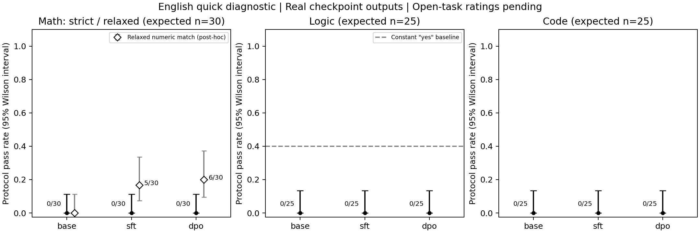
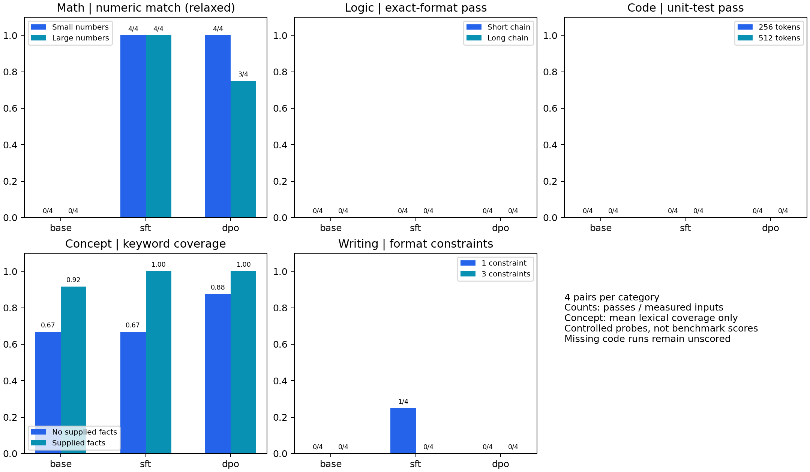

# Real-checkpoint capabilities and boundaries: first diagnostic

The diagnostic used 420 model responses on 2026-11-15. The fixed English instruction interface is part of the measurement. The format-relaxed numerical comparison is post hoc. Open-ended concept and writing answers await blinded human evaluation. See the per-response scores and controlled probes below.

[Protocol and review rubric](../capability-evaluation.md) · [Per-response scores](scores.json) · [Provenance manifest](manifest.json)

On 2026-11-15, the existing Qwen2.5-0.5B Base, SFT and DPO course checkpoints produced **420 formal responses**. Strict instruction-protocol success was low. A secondary analysis found some numerically correct math answers whose final-answer format failed the strict scorer. **Concept and writing quality remain pending human review.** These results do not establish an overall DPO improvement.

## Scope and protocol

Each stage received 100 main tasks: 30 math, 25 logic, 25 code, 10 concept and 10 writing. Another 40 inputs form 20 controlled pairs. That gives 300 main and 120 diagnostic responses across stages. Diagnostic probes intentionally reuse questions; they are interventions, not additional independent benchmark examples. Thirty development outputs are excluded.

Generation used seed 42, FP16, greedy decoding, batch size one, shared user/assistant ChatML and normally 256 output tokens. Code-budget probes also used 512. SFT and the final DPO adapter were loaded separately onto Base; adapters were not stacked and no new training occurred. Hardware was an RTX 3060 Laptop with 6GB. Configuration, weight, data and raw-log hashes are in the [manifest](manifest.json).

Math and code are sampled from the [official GSM8K test split](https://github.com/openai/grade-school-math) and [HumanEval](https://github.com/openai/human-eval). Other tasks are narrow project-authored probes. All 1,319 locally converted GSM8K question/answer pairs matched the official data in an [independent check](official-data-check.json). The [suite index](suite-index.json) preserves selected IDs and prompt hashes.

## Main results



Black markers show strict protocol success; diamonds show post-hoc relaxed math numeric matching. Error bars are 95% Wilson intervals under a binomial sampling assumption. Similar generated templates limit that interpretation. These intervals do not measure universal ability; zero observed passes do not establish a true population rate of zero.

| Metric | Base | SFT | DPO |
| --- | ---: | ---: | ---: |
| Math: strict answer protocol | 0/30 | 0/30 | 0/30 |
| Math: relaxed final-answer format, post-hoc | 0/30 | 5/30 (16.7%) | 6/30 (20.0%) |
| Logic: exact requested answer | 0/25 | 0/25 | 0/25 |
| Code: valid syntax and passing tests | 0/25 | 0/25 | 0/25 |
| Concept quality | 10 pending | 10 pending | 10 pending |
| Writing quality | 10 pending | 10 pending | 10 pending |

The secondary math extractor accepts explicit final-answer phrase variations while preserving the original boxed-answer semantics. It does not take an arbitrary last number. Added after observing SFT format failures, it is applied consistently to all stages and never replaces the strict score. Matching a number does not prove valid reasoning. SFT and DPO relaxed intervals are 7.3%–33.6% and 9.5%–37.3%. A one-question difference is insufficient evidence for a general training-method advantage.

The generated logic suite is simple and answer-imbalanced: always answering `yes` scores 10/25 (40%). It exposes basic instruction failures but does not measure general reasoning. A future balanced holdout should be a separate evaluation, preserving this frozen denominator.

Code scoring checks function presence and syntax, then runs tests in Docker without network or host mounts, as a non-root user with resource, time and output limits. All 25 selected canonical implementations passed the [same harness](canonical-code-check.json). No code answer was excluded for unavailable execution infrastructure.

| Code failures, 25 answers per stage | Base | SFT | DPO |
| --- | ---: | ---: | ---: |
| Syntax errors | 17 | 12 | 23 |
| Runtime errors or failed tests | 8 | 13 | 2 |

These are one-completion successes under this interface, not full HumanEval scores. Fewer runtime/test failures in DPO do not imply better code: more outputs failed the earlier syntax check.

## Controlled boundary probes



Each category contains only four pairs. Panels use different metrics and must not be pooled. Math uses relaxed numeric matching, logic and writing require the requested format, and concepts measure keyword coverage rather than factual accuracy.

| Intervention or observation | Base | SFT | DPO |
| --- | ---: | ---: | ---: |
| Small multiplication / numbers scaled by 1,000 | 0/4 → 0/4 | 4/4 → 4/4 | 4/4 → 3/4 |
| Short / long ordering chain | 0/4 → 0/4 | 0/4 → 0/4 | 0/4 → 0/4 |
| Code output budget: 256 / 512 tokens | 0/4 → 0/4 | 0/4 → 0/4 | 0/4 → 0/4 |
| No facts / supplied facts: mean keyword coverage | 0.67 → 0.92 | 0.67 → 1.00 | 0.88 → 1.00 |
| One / three writing-format requirements | 0/4 → 0/4 | 1/4 → 0/4 | 0/4 → 0/4 |
| Length stops across all 140 responses | 120/140 | 19/140 | 28/140 |

SFT matched the correct product on these eight single-step multiplication inputs. This supports that narrow observation. DPO repeatedly emitted the correct 32000 on `dmath-1-large`, then exhausted its budget at an unfinished final-answer marker, causing extraction to fail. Its 3/4 result does **not** establish a large-number arithmetic threshold. Frozen diagnostic prompts retained a `NUMBER` placeholder despite an appended plain numeric-answer instruction; placeholder copying is another design limitation.

Increasing the code budget did not recover a passing solution on these four probes. Both ordering conditions failed, so this experiment cannot locate a reasoning-length threshold. Supplied facts increased lexical coverage; copying keywords is not understanding. Writing probes check verifiable line-format requirements, not overall writing quality.

## Evidence and explanations

[Objective excerpts](objective-cases.json) include the first failure by sorted ID in each objective category, one secondary math improvement and one format-sensitive multiplication probe. Full raw responses stay local. Selected examples supplement the full counts.

- **Substantive math error:** `gsm-1034` requires total spending of 66. SFT and DPO answered 234, mishandling quantities and adding starting funds. Relaxing the answer format cannot repair that error.
- **Single-item improvement:** `gsm-1206` changed from SFT's 15000 to DPO's correct 40000. This accounts for the extra relaxed match, not a universal DPO benefit.
- **Interface and stability:** Base often repeated prompts and hit the length limit on 120/140 responses. A shared ChatML instruction interface confounds instruction alignment with underlying task skill; these outputs do not show that the pretrained model intrinsically lacks every tested skill.
- **Code artifacts:** Outputs included unmatched strings, prose in code, copied function documentation and undefined names. Canonical solutions passing the same harness argue against a universal environment failure, but do not identify the internal training cause.
- **Data hypotheses:** Structural screening found one duplicate SFT prompt and 193/1000 DPO prompts matching meta-instructions about generating preference pairs. These are [audit candidates](training-audit-summary.json), not 193 confirmed invalid records. Data quality, preference direction and model capacity remain hypotheses requiring manual audits and independently retrained controls.

There is only one training checkpoint per stage. Some concepts cover familiar training themes. No lexical-overlap candidates were found, but lexical screening proves neither semantic novelty nor absence of pretraining contamination. Chinese, multi-turn conversation, long context, tools, full benchmarks and training-run variance were not evaluated.

## Human review and reproduction

The local `outputs/capability/final-run/blind-review.csv` contains 60 open-task responses plus six consistency repeats, with stage identities hidden. Fill three integer rating columns from 1 to 5 using the [anchored rubric](../capability-evaluation.md#anonymous-scoring--Anonymous manual score). Repeats are excluded from capability means. Single-reviewer judgments and potentially recognizable styles remain limitations. No human scores are estimated while review is pending.

With `.[viz]` installed, regenerate the figures directly from published statistics:

```sh
python -m nlp_course.capability render --run-dir docs/capability-results
```

Each figure has SVG and 180-DPI PNG versions. [analysis.json](analysis.json) stores intervals, strict stage transitions and all paired probes; [scores.json](scores.json) stores per-input statuses. Inspect regenerated figures and refresh manifest hashes when updating them. Full checkpoint execution follows the [workflow](../capability-evaluation.md). Weights are not uploaded, so a clone can reproduce plots; regenerating model answers additionally requires the original checkpoints and data. These results remain separate from the synthetic CPU implementation-validation figures.
