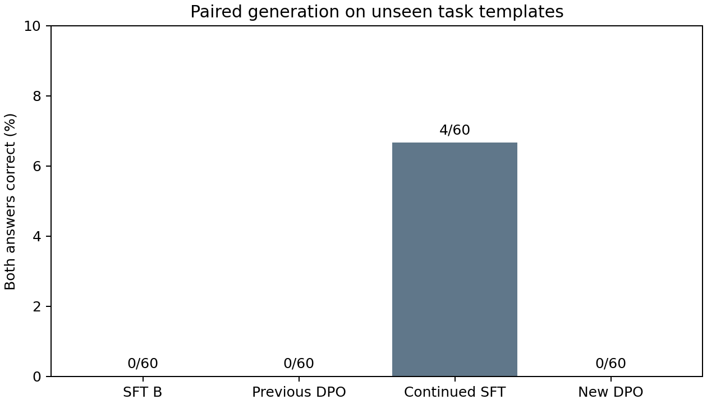
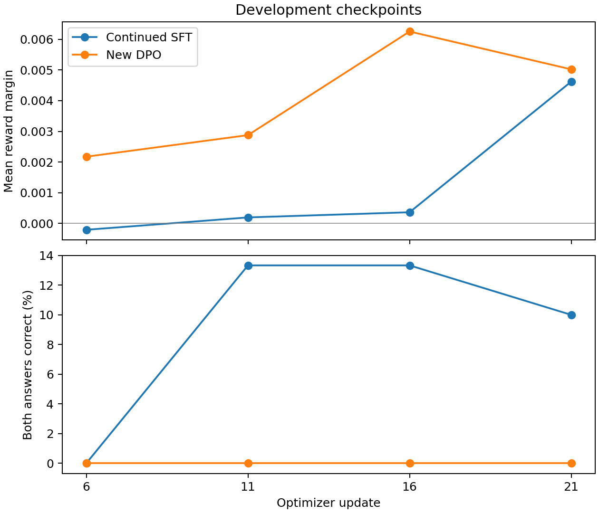

# Does training on a model’s own mistakes improve its reasoning?

A Qwen2.5-0.5B adapter answered 20 of 40 yes/no questions correctly by always saying *yes*. We changed one condition at a time and required both answers in each pair to be right. This distinguished a correct inference from a successful guess. [完整中文报告](README.zh-CN.md)

| Model | Correct pairs / 60 | Correct questions / 120 | Valid format / 120 |
| --- | ---: | ---: | ---: |
| Frozen SFT B | 0 | 20 | 49 |
| Previous DPO, 28 updates | 0 | 20 | 55 |
| Continued SFT | 4 | 24 | 66 |
| DPO with observed model errors | 0 | 20 | 53 |

The two new models started from the same SFT B adapter. They trained for one pass over the same 166 prompts in the same order. Continued SFT learned from validated correct responses. DPO also saw errors generated by the frozen model. Both used a learning rate of 5e-6 and an effective batch size of eight. At the selected checkpoints, DPO still answered *yes* on every held-out judgment question. Continued SFT solved four of those pairs. No model solved an ordering or counting pair. Against continued SFT, the paired DPO difference was −6.7 percentage points (group bootstrap 95% interval −13.3 to −1.7). This single-seed result applies to the frozen English templates.

The first panel measures the mean reference-relative log-probability difference between the correct answer and the sibling answer, multiplied by beta. DPO increased this margin from zero, while greedy paired accuracy stayed at zero. Continued SFT selected update 11. DPO selected update 6 under the earliest-tie rule. Neither additional seeds nor the conditional hybrid objective met the development criteria.

On the historical 30 math and 25 code tasks, frozen SFT B scored 9 and 6. The previous DPO scored 10 and 6, continued SFT scored 9 and 5, and the new DPO scored 10 and 5. Both new adapters lost the same previously passing code task, HumanEval-47.

The [Chinese report](README.zh-CN.md) includes mining yield, regression results, examples, limitations, and reproduction commands. Inspect the [per-question generations](generations.json), [preferences](pairs.json), [compressed candidate audit](mining.json.gz), [checkpoint measurements and hashes](metrics.json), [math and code results](regression.json), and [file checksums](manifest.json).
