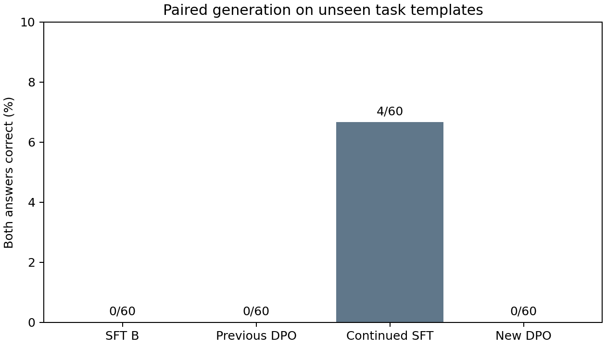
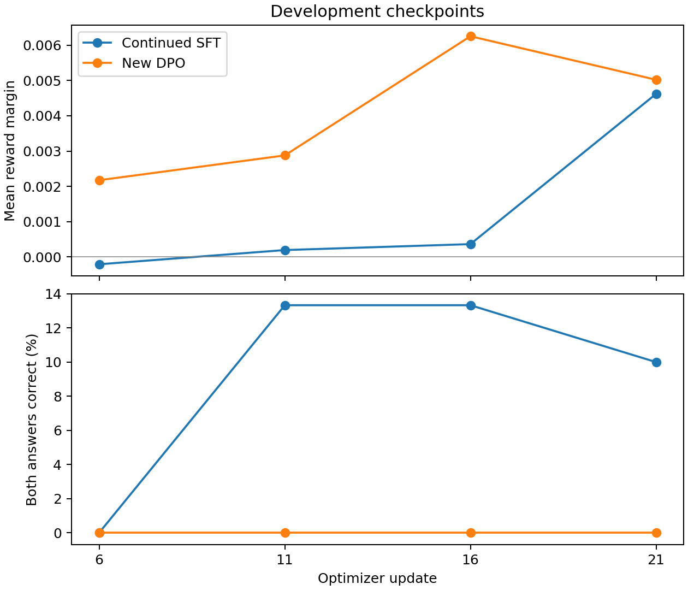

# 改变一个条件后，DPO 能让模型两次都答对吗？

在 60 个保留题组上，继续 SFT 两题都答对了 4 组，升级 DPO、冻结 SFT B 和上一轮 DPO 各为 0 组。升级 DPO 的 40 个判断题回答全部为 `yes`，恰好答对其中 20 题。单题分数掩盖了模型对条件变化的不敏感。本次实验没有达到相对冻结 SFT 和继续 SFT 各净增 6 组的目标。[English](README.md)

## 保留集上的四组对照

| 模型 | 两题均对 / 60 | 单题正确 / 120 | 格式合规 / 120 | 判断 / 20 组 | 排序 / 20 组 | 计数 / 20 组 |
| --- | ---: | ---: | ---: | ---: | ---: | ---: |
| 冻结 SFT B | 0（0%） | 20（16.7%） | 49（40.8%） | 0 | 0 | 0 |
| 上轮 DPO（28 步） | 0（0%） | 20（16.7%） | 55（45.8%） | 0 | 0 | 0 |
| 继续 SFT（第 11 步） | 4（6.7%） | 24（20.0%） | 66（55.0%） | 4 | 0 | 0 |
| 升级 DPO（第 6 步） | 0（0%） | 20（16.7%） | 53（44.2%） | 0 | 0 | 0 |



| 升级 DPO 相对谁 | 错→对 | 对→错 | 净变化 | 成对正确率差，95% 区间 |
| --- | ---: | ---: | ---: | --- |
| 冻结 SFT B | 0 | 0 | 0 组 | 0.0 个百分点 [0.0, 0.0] |
| 继续 SFT | 0 | 4 | −4 组 | −6.7 个百分点 [−13.3, −1.7] |

区间用固定种子 42、按同一组的两个模型得分差重采样 10,000 次。冻结组比较中，60 个观测差全部为零，因而经验区间退化为零。这项结果对其他模板、任务或训练种子的外推能力有限，模板内题组的相关性也可能使区间偏窄。[逐题提示、原始输出及判定](generations.json)

## 偏好采集到底学到了什么信号

冻结 Qwen2.5-0.5B 的 SFT B 适配器，每个提示生成 1 次 greedy 和 3 次采样回答（温度 1.25，top-p 0.98）。只接受模型实际生成、格式可解析、内容错误且正常结束的负例，以回答字符长度差最小为配对准则。模型没有生成正确回答时，由求解器提供正例。判断题按正确答案平衡为 48 个 yes 和 48 个 no。

| 类别 | 尝试提示数 | 存在合格错答 | 无合格错答 | 最终入选 / 目标 | 入选率 | 模型 / 求解器正例 |
| --- | ---: | ---: | ---: | --- | ---: | --- |
| 判断 | 168 | 133 | 35 | 96 / 96 | 57.1% | 78 / 18 |
| 排序 | 200 | 66 | 134 | 64 / 64 | 32.0% | 5 / 59 |
| 计数 | 256 | 6 | 250 | 6 / 64 | 2.3% | 0 / 6 |

共采集 624 个提示的 2,496 个回答。205 个提示含合格错答，166 个进入训练。39 个合格提示因配额或标签平衡被舍弃。计数题已用完四倍配额，两个训练组都使用相同的六条计数偏好。保留集上四组模型均未返回一个合规的计数答案，严格得分无法区分有正确中间计算的解释和计算完全错误的解释。[训练偏好清单](pairs.json) · [全部候选、格式判定及淘汰记录](mining.json.gz)

## 训练、开发集与选模

种子 42，两组从相同适配器出发，用同一顺序训练一轮。LoRA 的秩为 16，alpha 为 32，dropout 为零，作用于注意力的 Q、K、V 和输出投影。AdamW 学习率为 5e-6，有效批大小 8，最后一批 6 对。继续 SFT 只学习正确回答；DPO 的 β 为 0.1，参考分数在任何更新之前从 SFT B 计算并固定。单卡 RTX 3060 6 GB，BF16。

| 优化步 | 继续 SFT 两题均对 / 30 | DPO 两题均对 / 30 | DPO 正确回答 Δlog p | DPO 错误回答 Δlog p | DPO 偏好差 |
| ---: | ---: | ---: | ---: | ---: | ---: |
| 6 | 0 | 0 | +0.169 | +0.147 | +0.0022 |
| 11 | 4 | 0 | +0.299 | +0.271 | +0.0029 |
| 16 | 4 | 0 | +0.451 | +0.389 | +0.0063 |
| 21 | 3 | 0 | +0.592 | +0.542 | +0.0050 |

开发集每个提示都以另一道同组题的参考答案作诊断错答。表中 Δlog p 是整段回答（含结束符）的对数概率相对冻结 SFT 的变化，在 60 个提示上取平均。偏好差为两列之差乘 β。DPO 提高了正确回答的概率，也提高了错误回答的概率；提升的相对幅度不足以让 greedy 多解出一组。冻结 SFT B 与上轮 DPO 的开发集成绩同为 0/30。



按开发集最高成对正确率选模，同分取最早更新。DPO 未比两项对照都多答对 3 个开发题组，因此未触发种子 43、44。DPO 的正确回答平均对数概率在四次评估间持续上升，也未触发预设的辅助交叉熵实验。选模决定先写入本地记录，再统一运行保留集。

| 训练组 | 优化更新数 | 参与损失的回答及结束 token | GPU 同步训练用时 |
| --- | ---: | ---: | ---: |
| 继续 SFT | 21 | 476（正确回答） | 31.1 秒 |
| 升级 DPO | 21 | 1,163（正确和错误回答） | 55.5 秒 |

用时涵盖梯度计算和优化器更新，不含模型加载、偏好采样、参考分数预计算及开发集生成。详细顺序哈希、每个 checkpoint 的两侧分数及选定权重的 SHA-256 见[实验数据](metrics.json)。

## 一对改善案例，一对退化案例

- **SFT 相对冻结模型的整组改善**。`holdout-judgment-3` 中，规则依次蕴含 birch → ash → oak → cedar。将标本从 elm 改为 birch，能否推出 cedar 的答案从 no 变为 yes。冻结 SFT B 和升级 DPO 都给出 yes / yes，继续 SFT 给出 no / yes。升级 DPO 相对继续 SFT 在这组失去一分。
- **SFT 的单题退化与 DPO 的局部改善**。`holdout-judgment-7` 的两种起点为 elm 和 ash，规则蕴含 ash → pine → cedar → oak。正确答案为 no / yes，继续 SFT 给出 no / no，升级 DPO 给出 yes / yes。DPO 答对了 SFT 答错的第二题，同时丢掉了第一题，两个模型在这组都得零分。本次没有可展示的 DPO 整组改善案例。

## 数学与代码回归

同一批 30 道 GSM8K 和 25 道 HumanEval 使用相同的 greedy 解码、BF16、推理批大小 4 和 256 个新 token 的上限。数学沿用严格最终答案提取，代码在禁网 Docker 容器中运行测试。上一轮报告使用 FP16、批大小 1，故下表用本轮重新生成的冻结 SFT B 回答作对照。[逐题回答、提取结果与执行状态](regression.json)

| 模型 | 数学 / 30 | 数学新增 / 丢失 | 代码 / 25 | 代码新增 / 丢失 |
| --- | ---: | ---: | ---: | ---: |
| 冻结 SFT B | 9 | — | 6 | — |
| 上轮 DPO | 10 | 2 / 1 | 6 | 1 / 1 |
| 继续 SFT | 9 | 1 / 1 | 5 | 0 / 1 |
| 升级 DPO | 10 | 1 / 0 | 5 | 0 / 1 |

两个新训练组都新答对了 `gsm-237`，都在原先通过的 `HumanEval-47` 上退化。继续 SFT 还丢掉了 `gsm-337`。这些变化分别涉及一两道题，不足以断言整体数学或代码能力发生了稳定变化。

## 冻结规则与复现

训练、开发和保留集分别使用独立模板族。判断链分别为 1、2、3 跳，替换起始事实；排序分别含 3、4、5 个元素，打乱约束并反转一条关系，对全排列验证唯一解；计数分别使用从两色物品中取走、向两色物品中补充、从三色物品中移出的情境，改变提问范围。同组换条件的两个参考答案必须不同。难度随划分变化，这个设计同时检验条件变化与更难模板上的迁移，无法分离两种效应。

评分先剥离首尾空白。判断只接受 yes/no，排序只接受逗号分隔的字母，计数只接受整数字符串；大小写忽略，比较时移除普通空格。额外解释、冲突答案及耗尽生成预算均按错误计分。四组使用同一提示和 greedy 解码，成对题上限 40 个新 token，遇到 Base EOS 或 ChatML 结束符即停。题目 SHA-256 为 `9431707f5829b4ec76e54f157e7be0eb288f7161e9529094cb821fa7227d1bf3`。[完整配置、权重和回归题哈希](metrics.json)

在仓库根目录使用已安装本项目和训练依赖的 CUDA 环境，按上一轮训练指南准备本地 Qwen 快照、SFT B、28 步 DPO 适配器及历史题集。四个路径由配置指定。代码复测使用已有 Docker 隔离评分器及本地镜像 `python:3.11-slim`。[准备本地资产](../training.md) · [实验配置](../../configs/paired-dpo.json)

```sh
python -m nlp_course.training paired-freeze --config configs/paired-dpo.json
python -m nlp_course.training paired-collect --config configs/paired-dpo.json
python -m nlp_course.training paired-run --config configs/paired-dpo.json
python -m nlp_course.paired_regression --config configs/paired-dpo.json
python -m nlp_course.paired_report --config configs/paired-dpo.json --output docs/paired-dpo-results
```

仅从公开结果重绘两张图时，安装项目的 viz 依赖后运行以下命令。文件摘要可用来核对下载和导出的结果。[SHA-256 清单](manifest.json)

```sh
python -m nlp_course.paired_report --metrics docs/paired-dpo-results/metrics.json --output outputs/paired-figures
```
