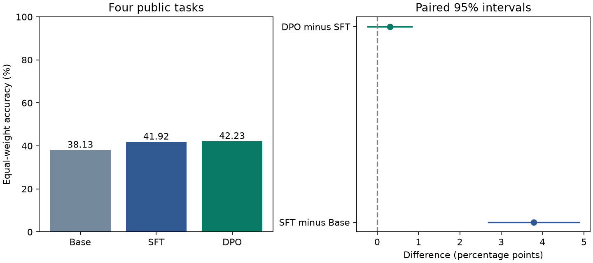
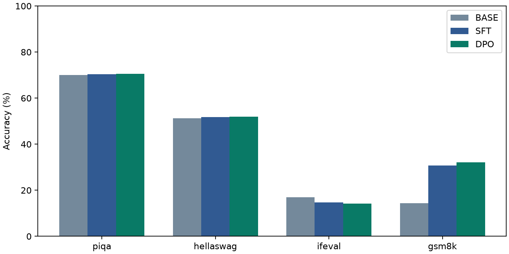

# Qwen2.5-0.5B 单次 SFT 与单次 DPO 的公开评测

共尝试 2 轮，正式验收通过。下表来自锁定最终权重后的全量描述性评测。每个阶段测 13,680 道题，四项等权。DPO 从选中的 SFT 出发训练一轮。

| 阶段 | PIQA | HellaSwag | IFEval 严格提示级 | GSM8K | 等权均分 |
|---|---:|---:|---:|---:|---:|
| BASE | 69.97% | 51.25% | 17.01% | 14.30% | 38.13% |
| SFT | 70.35% | 51.80% | 14.79% | 30.74% | 41.92% |
| DPO | 70.57% | 52.02% | 14.23% | 32.09% | 42.23% |

## 封存题正式验收

| 轮次与题集 | Base 综合分 | SFT 综合分 | DPO 综合分 | SFT 增益 / 校正单侧下界 | DPO 增益 / 校正单侧下界 |
|---|---:|---:|---:|---:|---:|
| 第 2 轮 / 集合 1 | 37.04% | 41.58% | 42.66% | +4.53 / +2.256 | +1.08 / +0.055 |

封存题决定是否验收。全量评测在训练结束后进行，含已开封的题目。两张表分别回答预定门槛是否达成，以及这条训练路径在完整评测范围内表现如何。增益和下界以百分点计。

## 两段公开能力变化

| 阶段 | 综合分差（百分点） | 配对 95% 区间 | 回退最大的任务及变化（百分点） |
|---|---:|---:|---|
| SFT | +3.79 | [+2.67, +4.90] | ifeval -2.22 |
| DPO | +0.31 | [-0.24, +0.85] | ifeval -0.55 |

全量评测中，DPO 相对 SFT 的综合增益为 +0.31 个百分点，配对 95% 区间包含零。封存题上观察到的增益幅度在更大题集上未得到确认。
全量 ifeval 上，SFT 相对前一阶段下降 2.22 个百分点，超过预设的 2 点回退线。

## 迭代记录

| 轮次 | SFT 开发增益 | DPO 开发增益 | 通过开发门槛后开封的集合 | 单卡运行分钟 |
|---|---:|---:|---|---:|
| 1 | +6.64 | +1.56 | — | 28.3 |
| 2 | +6.64 | +1.17 | 1 | 85.1 |

第 1 轮开发评估中，DPO 相对上阶段变化 +1.56 个百分点。ifeval 从错到对 1 题、从对到错 4 题，下降 2.34 个百分点。
下一轮从同一 SFT 出发，优先采集首次回答错误且候选中有正确回答的训练题。
第 2 轮两段提升均通过封存题验收。

开发增益以百分点计。指令开发集使用独立编写的练习，公开验收和全量评测使用原版 IFEval。单卡运行时间含本轮开发评估与偏好采集。各次重训的配置、逐项错转对与对转错题数、正负回答的概率变化见指标文件。
在 NVIDIA GeForce RTX 5090 上，从环境验证至全量评测写入结果历时 2.98 小时。该时间包含等待与评分，不等于 GPU 内核执行时间。

[训练与复现说明](../progression.md)

完整记录包括未达标的轮次、正式验收状态、封存题哈希、逐题输出与改善和退化案例。公开题存在历史暴露，结论限定在本次单种子权重和冻结协议。

[指标与验收](metrics.json) · [逐题结果](predictions.jsonl.gz) · [变化案例](cases.json)
