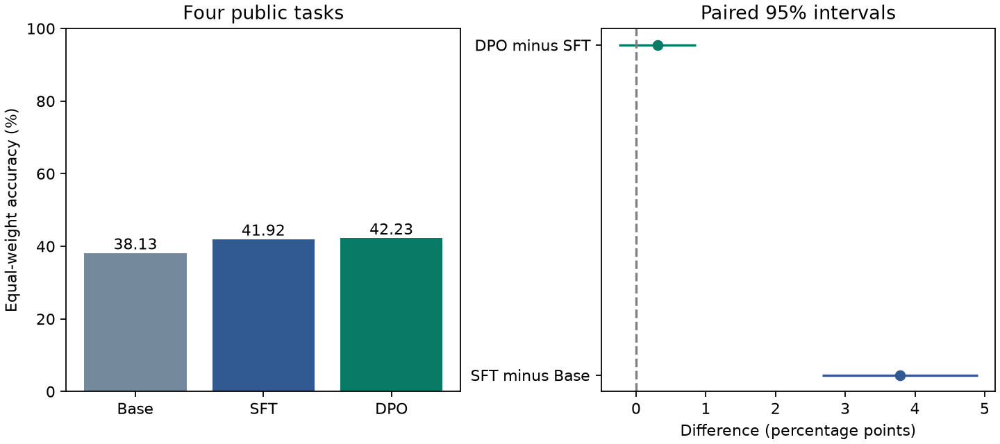
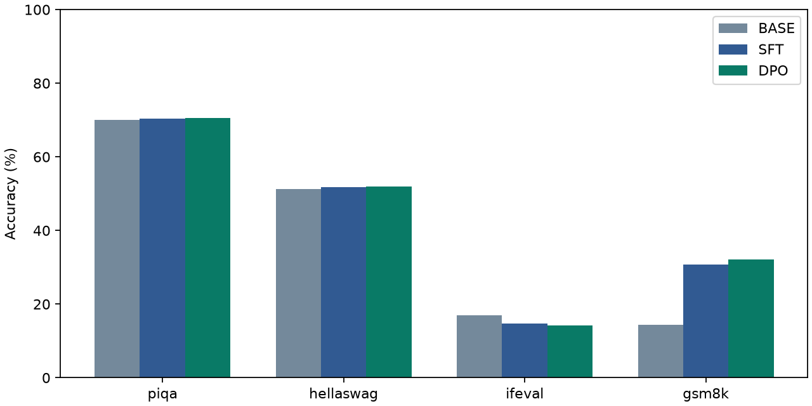

# Qwen2.5-0.5B public evaluation after one SFT stage and one round of DPO

Across 2 attempts, the prespecified holdout criteria were met. After checkpoint selection, each stage was evaluated on 13,680 questions with equal weight for each of the four tasks. DPO started from the selected SFT checkpoint.

| Stage | PIQA | HellaSwag | IFEval strict prompt-level | GSM8K | Equal-weight mean |
|---|---:|---:|---:|---:|---:|
| BASE | 69.97% | 51.25% | 17.01% | 14.30% | 38.13% |
| SFT | 70.35% | 51.80% | 14.79% | 30.74% | 41.92% |
| DPO | 70.57% | 52.02% | 14.23% | 32.09% | 42.23% |

## Prespecified holdout evaluation

| Attempt and panel | Base mean | SFT mean | DPO mean | SFT gain / adjusted one-sided lower bound | DPO gain / adjusted one-sided lower bound |
|---|---:|---:|---:|---:|---:|
| Attempt 2 / panel 1 | 37.04% | 41.58% | 42.66% | +4.53 / +2.256 | +1.08 / +0.055 |

The sealed panel determines acceptance. The full benchmark includes the opened questions and describes the selected checkpoints after training. Gains and lower bounds are in percentage points.

## Changes on the full benchmark

| Stage | Mean change (pp) | Paired 95% interval | Largest task regression (pp) |
|---|---:|---:|---|
| SFT | +3.79 | [+2.67, +4.90] | ifeval -2.22 |
| DPO | +0.31 | [-0.24, +0.85] | ifeval -0.55 |

The full-benchmark DPO gain over SFT was +0.31 percentage points. Its paired 95% interval includes zero, so the larger evaluation does not confirm the gain observed on the sealed panel.
On the full ifeval benchmark, SFT fell 2.22 percentage points from the previous stage, exceeding the two-point regression threshold.

## Training attempts

| Attempt | SFT development gain | DPO development gain | Panel opened after selection | Single-GPU minutes |
|---|---:|---:|---|---:|
| 1 | +6.64 | +1.56 | — | 28.3 |
| 2 | +6.64 | +1.17 | 1 | 85.1 |

On attempt 1, the development change for DPO relative to the previous stage was +1.56 percentage points.ifeval gained 1 correct responses and lost 4, a decline of 2.34 percentage points.
The next attempt started from the same SFT checkpoint and prioritized prompts with an incorrect first response and a correct alternative.
Both gains met the sealed-panel criteria on attempt 2.

Development gains are in percentage points. Instruction development uses independent exercises. The sealed and full public evaluations use original IFEval. Timing includes development evaluation and preference collection. Metrics include configurations, paired gains and losses, and changes in answer probabilities.
On NVIDIA GeForce RTX 5090, environment verification through final result writing took 2.98 hours including waiting and scoring.

[Training and reproduction](../progression.md)

The records include unsuccessful attempts, acceptance decisions, holdout hashes, individual outputs and examples of gains and regressions. Historical exposure to public questions limits conclusions to this seed, these checkpoints and this protocol.

[Metrics and acceptance](metrics.json) · [Per-question results](predictions.jsonl.gz) · [Examples](cases.json)
