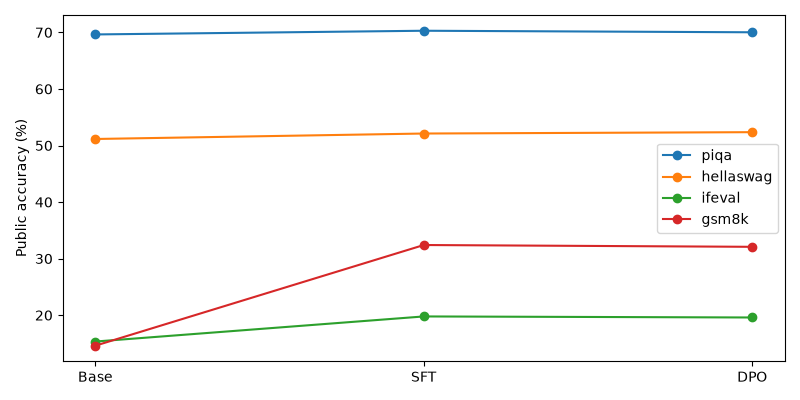
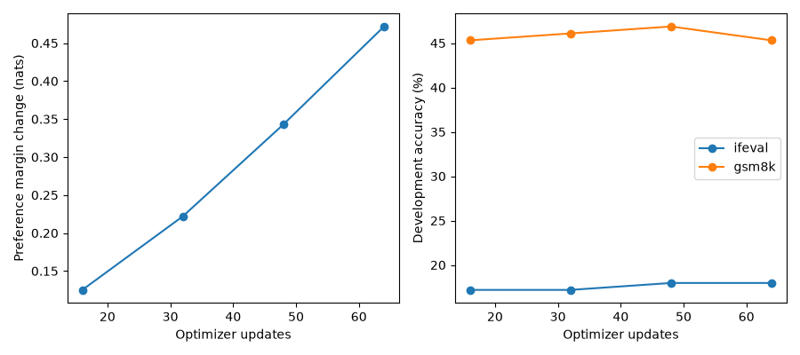

# Completion-boundary ablation and one-stage DPO

**Tokenization and transfer.** Boundary tokens could span the end of a prompt and the first character of a completion. The repair recovered 643 instruction SFT targets and 136 chosen DPO responses and reproduced all 1,024 archived completions verbatim. Replaying 64 updates from the old SFT checkpoint yielded 11 instruction gains, one loss and a 1.76-point mean increase on the original development set. The historical and replay runs used an RTX 5090 and an RTX 4090, respectively.

From update 48 to 64 the training preference margin continued to grow while the development score fell from 47.85% to 47.46%. At update 48, SVAMP had 21 gains and 15 losses relative to SFT, and the in-house instruction tasks had five gains and six losses. DPO correctly subtracted 70 from 253 to give 183 in one case. In another case SFT correctly computed 80 + 54 − 36 = 98 and DPO answered 26. The holdout included 512 SVAMP questions and custom sorting, filtering and formatting tasks, while the public run used GSM8K and IFEval. [Examples](cases.json)

[Reproduction](../progression-v2.md) · [Metrics, costs and hashes](metrics.json) · [Changed answers](cases.json)

## Holdout

| Model | PIQA | HellaSwag | Custom instructions | SVAMP | Mean |
|---|---:|---:|---:|---:|---:|
| base | 74.02% | 48.24% | 0.00% | 9.18% | 32.86% |
| sft | 73.05% | 50.20% | 10.16% | 23.44% | 39.21% |
| chosen | 72.66% | 50.59% | 12.50% | 27.54% | 40.82% |
| dpo | 73.44% | 50.39% | 9.96% | 24.61% | 39.60% |

- base-sft change +6.35 pp (95% CI +4.79 to +7.86), adjusted lower bound +4.49.
- sft-dpo change +0.39 pp (95% CI -0.34 to +1.12), adjusted lower bound -0.49.
- chosen-dpo change -1.22 pp (95% CI -2.05 to -0.44), adjusted lower bound -2.20.

## Public

| Model | PIQA | HellaSwag | IFEval strict | GSM8K | Mean |
|---|---:|---:|---:|---:|---:|
| base | 69.64% | 51.16% | 15.34% | 14.61% | 37.69% |
| sft | 70.29% | 52.12% | 19.78% | 32.41% | 43.65% |
| dpo | 70.02% | 52.36% | 19.59% | 32.09% | 43.52% |

- base-sft change +5.96 pp (95% CI +4.79 to +7.12), adjusted lower bound +4.53.
- sft-dpo change -0.13 pp (95% CI -0.65 to +0.39), adjusted lower bound -0.78.

Single-seed prospective gate: missed.
Incremental benefit of standard DPO over chosen-only training: not established.

Legacy step-64 repair contrast: +1.76 pp on the original development set.

## Attribution and training cost

The archived comparator was trained on an RTX 5090. The replay uses the same parent, examples, order and training settings on the available GPU.

| Task | Old wrong to new correct | Old correct to new wrong | Change (pp) |
|---|---:|---:|---:|
| piqa | 2 | 2 | +0.00 |
| hellaswag | 0 | 0 | +0.00 |
| ifeval | 11 | 1 | +7.81 |
| gsm8k | 6 | 7 | -0.78 |

| Training arm | GPU | Elapsed minutes including checkpoint scoring |
|---|---|---:|
| ablation | NVIDIA GeForce RTX 4090 | 5.9 |
| sft | NVIDIA GeForce RTX 4090 | 6.8 |
| dpo | NVIDIA GeForce RTX 4090 | 5.6 |
| chosen | NVIDIA GeForce RTX 4090 | 5.1 |

The prospective instruction task tests sorting and filtering under two output formats. The public suite uses original IFEval prompts. The public dataset was measured in a previous experiment; the confidence intervals condition on this seed and model.
