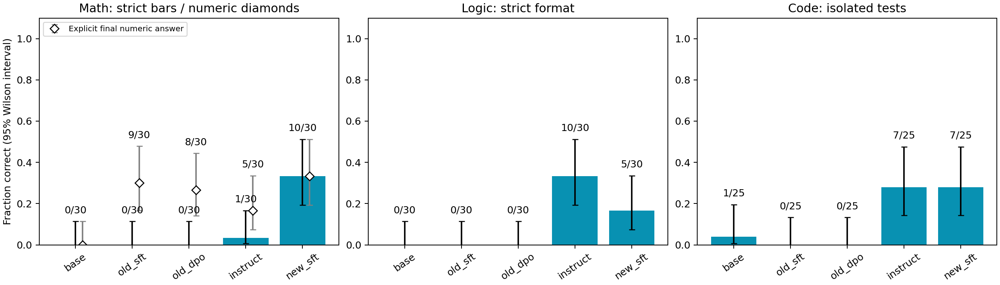
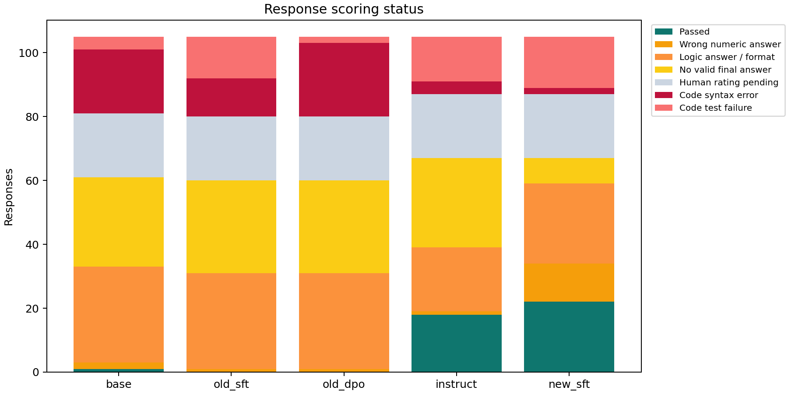

# 模型训练与评测修复结果

2026-11-18。本轮在独立保留集上完成五个模型共 525 条正式回答，每个模型为数学 30、逻辑 30、代码 25、概念 10、写作 10。模型在开发集上选定后才运行本轮保留集。

## 客观结果

new_sft 为本轮选定的 SFT B，old_sft/old_dpo 为原课程适配器，instruct 为官方同规模指令模型。

| 模型 | 数学严格协议 | 数学最终数值匹配 | 逻辑严格格式 | 代码测试通过 | 截断/105 |
|---|---:|---:|---:|---:|---:|
| base | 0/30 | 0/30 | 0/30 | 1/25 | 95/105 |
| old_sft | 0/30 | 9/30 | 0/30 | 0/25 | 6/105 |
| old_dpo | 0/30 | 8/30 | 0/30 | 0/25 | 16/105 |
| instruct | 1/30 | 5/30 | 10/30 | 7/25 | 25/105 |
| new_sft | 10/30 | 10/30 | 5/30 | 7/25 | 2/105 |

同一批保留题上，数学严格得分从 0/30 到 10/30，但数值匹配仅从 9/30 到 10/30，改善主要来自答案格式。代码测试通过从 0/25 到 7/25。逻辑的 5/30 全部来自正向判断题，等于恒答 yes 的基线；排序和计数仍为 0/10。代码语法错误从 12/25 降到 2/25，仍有 16/25 的代码未通过测试。



数学并列严格得分与明确最终答案数值匹配率，逐题状态和 Wilson 区间见 analysis.json。逻辑包含五真五假的判断题、10 道排序题、10 道计数题；判断题恒答 yes 的基线为 5/10。代码使用现有隔离 Docker 评分器，标准实现核验见 canonical-check.json。概念与写作的 100 条回答及 6 条重复检查已导出本地匿名表，质量分数待人工评分。



状态图包含待人工评分项。cases.json 按任务 ID 排序，分别取各客观任务的首个改善例和首个仍失败例，完整回答保留在本地。

## 实施与训练范围

- 将数据处理、SFT、DPO 和模型评测迁入仓库 CLI。仅对助手回答及结束符计算损失，超长样本按完整序列排除。
- 首次 16 题验证在 200 步后数值开头均正确，但完整回答为 0/16，出现越过原生结束符后的续写。改用 Base 原生结束符，从该适配器再训练 50 步，重载后完整回答为 16/16。这是训练链路检查。
- 正式 A/B 均从原 Base 独立初始化，各训练 50 个优化步、每步累积 8 个微批。A 使用结构校验的原课程数据，B 使用可验证的窄任务样本和官方 GSM8K train，按组划分并排除开发题。数据来源与任务分布共同发生了变化，A/B 差异不能单独归因于清洗。
- 开发集含数学、逻辑、简单代码各 10 题。A 三项等权均分 33.3%，B 为 63.3%，旧 SFT 为 0%。B 的数学为 4/10、逻辑 5/10、代码 10/10；逻辑分数等于该判断题集的恒答 yes 基线。
- DPO 使用从同一程序 oracle 构造的正确/错误回答对，冻结 SFT 的参考对数概率后训练 28 步，开发集均分仍为 63.3%。本轮展示选定 SFT，DPO 权重和负结果保留在本地。
- B 的原课程 2,000 条记录保留复核清单，未经逐条内容复核的课程回答未纳入 B。A 作为结构校验对照使用原 SFT 样本，其内容正确性没有人工保证。
- 训练为 BF16，正式生成是 FP16、greedy、显式 repetition penalty 1.0、batch size 1、每题上限 256 token。课程模型使用同一 ChatML 用户/助手格式，官方同规模 Instruct 使用原生模板。官方 Instruct 是外部参照。

## 复现与限制

安装项目及可视化依赖后，在仓库根目录运行下列命令，可从公开逐题统计重绘图表。公开配置包含统计索引，重新生成回答需要本地完整题目和课程权重。公开副本将本机模型目录替换为模型 ID 和本地权重占位路径，原始实验摘要与公开摘要均保留。

```sh
python -m nlp_course.capability render --experiment-config docs/repair-results/experiment.json
```

训练命令见 ../training.md，逐题成绩见 scores.json，训练及数据清单见 training.json，提示模板、停止符和权重哈希见 protocols.json。首次诊断报告仍保存在 ../capability-results。

这是一轮小规模英文任务实验。每个训练条件仅一个种子；Wilson 区间按二项抽样计算，模板题的相关性限制了外推；近似重叠筛查不能证明语义独立或排除预训练污染。Base 的结果包含固定指令接口适配的影响。开放题、中文、多轮、长上下文和训练方差均需另行测量。

课程目录 Q2.ipynb 中的明文密钥已改为读取 NLP_COURSE_API_KEY 环境变量，并清除了保存的输出。旧密钥需所有者在服务商后台撤销，本轮训练未调用付费生成 API。
