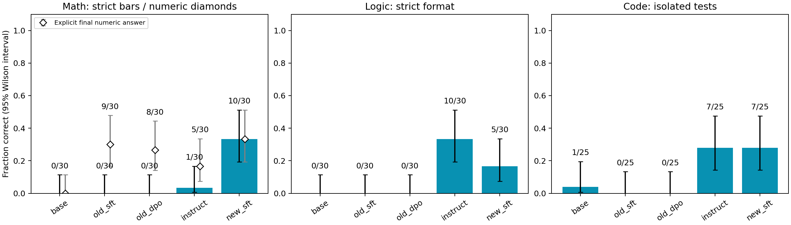
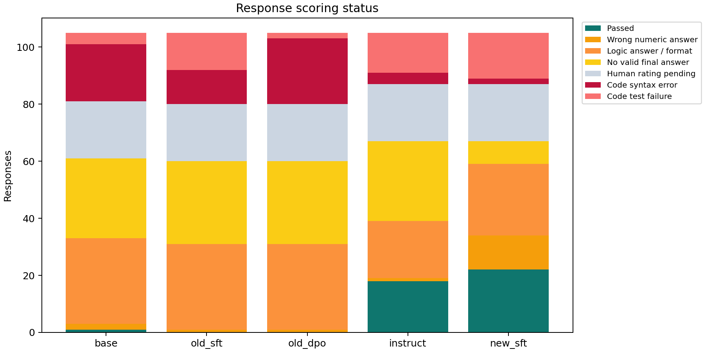

# Model repair evaluation

**Protocol notes.** On 2026-11-18, the independent holdout produced 525 answers. The logic set comprised five true and five false judgments, ten ordering questions and ten counting questions. Cases are chosen in task-ID order. Wilson intervals and per-question status are in the analysis artifact. One hundred open responses plus six repeated checks were exported for blinded review. Their quality scores are pending.

A 16-item smoke test produced correct numerical prefixes but zero fully correct completions after 200 steps. After switching to the Base model's native end token and continuing for 50 steps, all 16 complete responses passed after adapter reload. Training arms A and B were separately initialized from Base, used 50 optimizer updates and accumulated eight microbatches per update. On ten development questions per objective task, A achieved 33.3%, B 63.3% and old SFT 0% on the equal-weight mean. B scored 4/10 on mathematics, 5/10 on logic and 10/10 on code. The changed source and task mix limits attribution to cleaning alone.

The historical course notebook was updated to read NLP_COURSE_API_KEY from the environment and clear saved output. The original report advised revoking the previously exposed value. This training run did not call a paid generation API.

Completed 525 fixed English responses across Base, original SFT, original DPO, official same-size Instruct, and the repaired SFT. Each model received 30 mathematics, 30 logic, 25 code, 10 concept, and 10 writing tasks. Candidate selection used a separate development set.

| Model | Math strict | Math numeric | Logic strict | Code tests | Truncated / 105 |
|---|---:|---:|---:|---:|---:|
| base | 0/30 | 0/30 | 0/30 | 1/25 | 95/105 |
| old_sft | 0/30 | 9/30 | 0/30 | 0/25 | 6/105 |
| old_dpo | 0/30 | 8/30 | 0/30 | 0/25 | 16/105 |
| instruct | 1/30 | 5/30 | 10/30 | 7/25 | 25/105 |
| new_sft | 10/30 | 10/30 | 5/30 | 7/25 | 2/105 |



The original SFT to repaired SFT comparison shows code passes increasing from 0/25 to 7/25. Strict math passes increase from 0/30 to 10/30; explicit final numeric matches increase from 9/30 to 10/30, so much of the math change reflects answer formatting. Logic is 5/30, entirely positive entailment cases, equal to an always-yes baseline. Ordering and counting remain 0/10 each. Code syntax errors fall from 12/25 to 2/25; 16/25 repaired code responses still fail tests.



Open-task quality ratings are pending for 100 responses plus six blind consistency repeats. Wilson intervals use binomial assumptions; correlated task templates limit generalization.

- Training supervises completions and the native Base end token. A failed 200-step overfit run produced correct numerical prefixes with unwanted continuation. Continuing that adapter for 50 steps with the native end token yielded 16/16 complete answers after reload.
- The formal A/B runs start independently from Base and each use 50 optimizer steps with eight microbatches, BF16, rank-16 LoRA on q/k/v/o projections. A uses structurally validated coursework; B uses verified oracle tasks and official GSM8K train. A/B measures the combined change in source and task mixture.
- Development objective means are 0% for original SFT, 33.3% for A, and 63.3% for B. B achieves math 4/10, logic 5/10, and simple code 10/10. Its development logic score equals the always-yes baseline.
- DPO uses verified oracle preferences and a frozen SFT reference. After 28 steps, the development mean stays at 63.3%, so SFT B is the selected candidate. Preference validation is recorded separately.
- The original 2,000 coursework records have a content-review queue. B excludes unreviewed coursework responses. A is a structural control with no human content-correctness guarantee.
- Formal generation uses FP16, greedy decoding, repetition penalty 1.0, batch size one, and a 256-token limit. Coursework models use the shared ChatML interface; the official Instruct reference uses its native template.

Benchmark sources are the official GSM8K and HumanEval repositories. New benchmark IDs exclude the first published diagnostic subset. Base results reflect this instruction interface. Each training condition has one seed; pretraining contamination and semantic overlap remain possible. Chinese, multi-turn, long-context and training variance are unmeasured. [GSM8K](https://github.com/openai/grade-school-math), [HumanEval](https://github.com/openai/human-eval).

Re-render the public statistics from the repository root after installing plotting dependencies. Response regeneration requires the local full task suite and checkpoint files. Public model paths are replaced with model IDs and local checkpoint placeholders; weight fingerprints are retained.

```sh
python -m nlp_course.capability render --experiment-config docs/repair-results/experiment.json
```

Commands and evidence are available in the [training guide](../training.md), [per-task scores](scores.json), [training records](training.json), [protocols](protocols.json), [runtime](runtime.json), and [canonical-code check](canonical-check.json).

The coursework Q2 notebook now reads its API credential from NLP_COURSE_API_KEY and has saved outputs cleared. The owner must revoke the exposed credential through the provider. No paid generation API was used.
