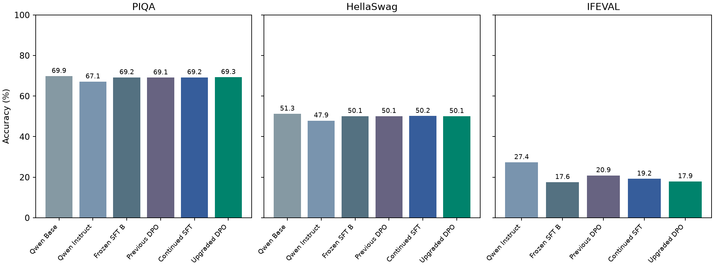
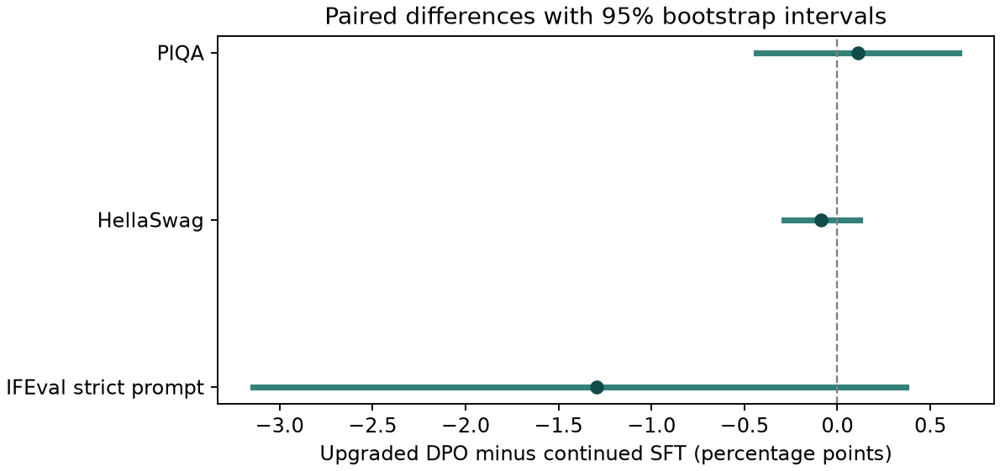

# Public evaluation of six Qwen checkpoints
[Detailed report](REPORT.md)

The primary comparison uses two adapters trained from SFT B on the same 166 prompts. Continued SFT learned the chosen answers and was selected at step 11. Upgraded DPO also trained on the model's rejected answers and was selected at step 6. The frozen SFT B and previous DPO checkpoints show how earlier stages performed. The two official Qwen checkpoints provide external baselines.

Upgraded DPO versus continued SFT changed PIQA, HellaSwag and IFEval strict prompt accuracy by +0.11, -0.09, -1.29 percentage points. Each model was selected before running these public tasks.

| Checkpoint | PIQA | HellaSwag | IFEval strict prompt |
|---|---:|---:|---:|
| Qwen Base | 1284/1838 (69.86%) | 5147/10042 (51.25%) | — |
| Qwen Instruct | 1234/1838 (67.14%) | 4811/10042 (47.91%) | 148/541 (27.36%) |
| Frozen SFT B | 1272/1838 (69.21%) | 5033/10042 (50.12%) | 95/541 (17.56%) |
| Previous DPO | 1270/1838 (69.10%) | 5032/10042 (50.11%) | 113/541 (20.89%) |
| Continued SFT | 1272/1838 (69.21%) | 5038/10042 (50.17%) | 104/541 (19.22%) |
| Upgraded DPO | 1274/1838 (69.31%) | 5029/10042 (50.08%) | 97/541 (17.93%) |

The PIQA references are 69.9% for Base and 67.2% for Instruct. The largest absolute difference from these references was 0.06 percentage points. The SmolLM2 card lists a prompt/instruction average for IFEval. We report all four upstream scores separately. [SmolLM2 model card](https://huggingface.co/HuggingFaceTB/SmolLM2-360M-Instruct#evaluation)

## Paired changes

| Task | Upgraded DPO compared with | Gained | Lost | Difference (pp) | 95% interval (pp) |
|---|---|---:|---:|---:|---:|
| piqa | Continued SFT | 15 | 13 | +0.11 | [-0.44, +0.65] |
| piqa | Frozen SFT B | 10 | 8 | +0.11 | [-0.33, +0.54] |
| piqa | Previous DPO | 16 | 12 | +0.22 | [-0.33, +0.76] |
| hellaswag | Continued SFT | 51 | 60 | -0.09 | [-0.29, +0.12] |
| hellaswag | Frozen SFT B | 40 | 44 | -0.04 | [-0.22, +0.14] |
| hellaswag | Previous DPO | 59 | 62 | -0.03 | [-0.24, +0.19] |
| ifeval | Continued SFT | 8 | 15 | -1.29 | [-3.14, +0.37] |
| ifeval | Frozen SFT B | 11 | 9 | +0.37 | [-1.29, +2.03] |
| ifeval | Previous DPO | 9 | 25 | -2.96 | [-4.99, -0.92] |

The paired intervals include zero on piqa, hellaswag, ifeval. These comparisons give no clear evidence of a DPO gain.
Intervals resample complete prompts 10,000 times with seed 42. They measure uncertainty over questions for the selected checkpoints. Training used a single seed.

## IFEval

| Checkpoint | Strict prompt | Strict instruction | Loose prompt | Loose instruction | Length-limited / 541 |
|---|---:|---:|---:|---:|---:|
| Qwen Instruct | 27.36% | 36.81% | 30.31% | 40.05% | 21 |
| Frozen SFT B | 17.56% | 30.10% | 18.85% | 31.77% | 155 |
| Previous DPO | 20.89% | 31.41% | 22.00% | 33.81% | 142 |
| Continued SFT | 19.22% | 31.53% | 19.96% | 32.97% | 150 |
| Upgraded DPO | 17.93% | 30.82% | 18.67% | 32.13% | 152 |

## Changed answers

For each direction we show the first changed question in the frozen order. Choice numbers below start at one. Full answers and candidate scores are in the prediction files.

| Task | DPO change against continued SFT | ID | Observed change |
|---|---|---|---|
| piqa | gain | piqa-571 | Choice 1 → 2, gold 2 |
| piqa | loss | piqa-31 | Choice 1 → 2, gold 1 |
| hellaswag | gain | hellaswag-144 | Choice 1 → 3, gold 3 |
| hellaswag | loss | hellaswag-284 | Choice 2 → 3, gold 2 |
| ifeval | gain | ifeval-1893 | Failed checks (SFT → DPO) startend:end_checker → all pass |
| ifeval | loss | ifeval-1072 | Failed checks (SFT → DPO) all pass → length_constraints:number_words |

## Runtime and reproduction

| Task | Model/question records | Synchronized batch time (min) | Peak allocated GPU memory (MiB) |
|---|---:|---:|---:|
| piqa | 11,028 | 2.6 | 2499 |
| hellaswag | 60,252 | 35.4 | 1808 |
| ifeval | 2,705 | 272.3 | 1176 |

Single RTX 3060 Laptop GPU (6 GB), Transformers BF16. Eight-question checks used batch one, formal runs used batch eight. Greedy outputs can change with batching. The first-eight agreement and per-checkpoint costs are recorded in metrics.json.

HellaSwag validation uses the author's frozen Parquet release. The original loader's GitHub data URL is unavailable. Raw-file equivalence to the old JSONL could not be verified.

[Reproduction commands](reproduce.md) · [Metrics and cases](metrics.json) · [Protocol fingerprints](protocols.json) · [File hashes](manifest.json)

[PIQA predictions](piqa-predictions.jsonl.gz) · [HellaSwag predictions](hellaswag-predictions.jsonl.gz) · [IFEval responses and checks](ifeval-predictions.jsonl.gz) · [Paired reasoning experiment](../paired-dpo-results/README.md)
