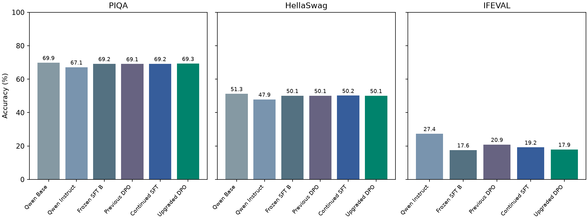
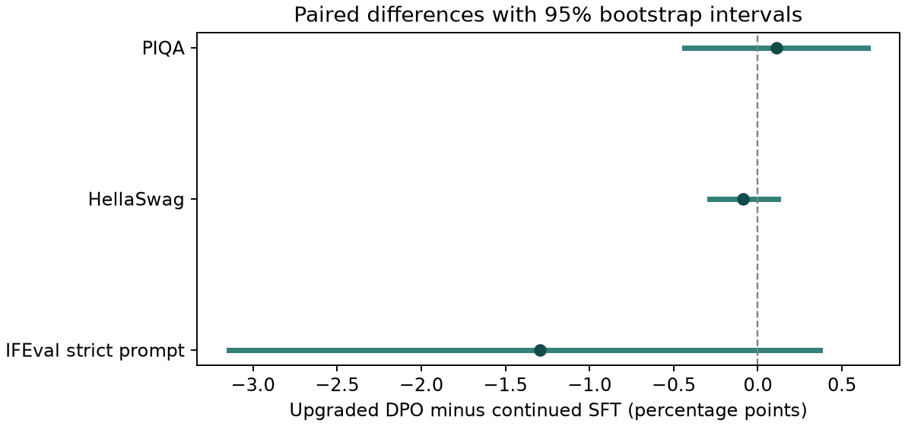

# 六组 Qwen 权重的 SmolLM2 公开评测
[English report](README.md)

主对照的两组权重均从 SFT B 出发，训练时使用相同的 166 条提示。继续 SFT 学习正确示范，选中第 11 步。升级 DPO 还使用模型实际生成的错答，选中第 6 步。冻结 SFT B 和上一轮 DPO 用于观察各训练阶段的表现，两组官方 Qwen 权重提供外部参照。

与继续 SFT 相比，升级 DPO 在 PIQA、HellaSwag 和 IFEval 严格提示级通过率上的差值依次为 +0.11, -0.09, -1.29 个百分点。所有项目权重均已在本次公开评测前选定。

| 模型 | PIQA | HellaSwag | IFEval 严格提示级 |
|---|---:|---:|---:|
| Qwen Base | 1284/1838 (69.86%) | 5147/10042 (51.25%) | — |
| Qwen Instruct | 1234/1838 (67.14%) | 4811/10042 (47.91%) | 148/541 (27.36%) |
| Frozen SFT B | 1272/1838 (69.21%) | 5033/10042 (50.12%) | 95/541 (17.56%) |
| Previous DPO | 1270/1838 (69.10%) | 5032/10042 (50.11%) | 113/541 (20.89%) |
| Continued SFT | 1272/1838 (69.21%) | 5038/10042 (50.17%) | 104/541 (19.22%) |
| Upgraded DPO | 1274/1838 (69.31%) | 5029/10042 (50.08%) | 97/541 (17.93%) |

SmolLM2 作者公布的 PIQA 参照为 Base 69.9%、Instruct 67.2%，本机两项与参照的最大绝对差为 0.06 个百分点。作者的 IFEval 表格给出提示级与指令级均值，未注明严格或宽松口径，本报告分别列出原版检查器的四项结果。 [SmolLM2 model card](https://huggingface.co/HuggingFaceTB/SmolLM2-360M-Instruct#evaluation)

## 同题改善、退化与差值区间

| 任务 | 升级 DPO 的对照 | 错→对 | 对→错 | 差值（百分点） | 95% 区间（百分点） |
|---|---|---:|---:|---:|---:|
| piqa | Continued SFT | 15 | 13 | +0.11 | [-0.44, +0.65] |
| piqa | Frozen SFT B | 10 | 8 | +0.11 | [-0.33, +0.54] |
| piqa | Previous DPO | 16 | 12 | +0.22 | [-0.33, +0.76] |
| hellaswag | Continued SFT | 51 | 60 | -0.09 | [-0.29, +0.12] |
| hellaswag | Frozen SFT B | 40 | 44 | -0.04 | [-0.22, +0.14] |
| hellaswag | Previous DPO | 59 | 62 | -0.03 | [-0.24, +0.19] |
| ifeval | Continued SFT | 8 | 15 | -1.29 | [-3.14, +0.37] |
| ifeval | Frozen SFT B | 11 | 9 | +0.37 | [-1.29, +2.03] |
| ifeval | Previous DPO | 9 | 25 | -2.96 | [-4.99, -0.92] |

配对区间包含零的任务有 piqa, hellaswag, ifeval。本次未取得这些任务上 DPO 额外增益的明确证据。
区间来自 10,000 次完整提示配对重采样，种子固定为 42。它衡量选定权重下抽取不同题目带来的波动。训练种子只有一个。

## IFEval

| 模型 | 严格提示级 | 严格指令级 | 宽松提示级 | 宽松指令级 | 达到输出预算 / 541 |
|---|---:|---:|---:|---:|---:|
| Qwen Instruct | 27.36% | 36.81% | 30.31% | 40.05% | 21 |
| Frozen SFT B | 17.56% | 30.10% | 18.85% | 31.77% | 155 |
| Previous DPO | 20.89% | 31.41% | 22.00% | 33.81% | 142 |
| Continued SFT | 19.22% | 31.53% | 19.96% | 32.97% | 150 |
| Upgraded DPO | 17.93% | 30.82% | 18.67% | 32.13% | 152 |

## 各任务的改善与退化样例

每个方向取冻结顺序中的首道变化题。下表中的选项从 1 开始编号。完整生成回答、候选分数及检查结果保存在逐题文件中。

| 任务 | DPO 相对继续 SFT | 题号 | 逐题变化 |
|---|---|---|---|
| piqa | 改善 | piqa-571 | 选项 1 → 2，参考选项 2 |
| piqa | 退化 | piqa-31 | 选项 1 → 2，参考选项 1 |
| hellaswag | 改善 | hellaswag-144 | 选项 1 → 3，参考选项 3 |
| hellaswag | 退化 | hellaswag-284 | 选项 2 → 3，参考选项 2 |
| ifeval | 改善 | ifeval-1893 | 未通过项（继续 SFT → DPO） startend:end_checker → 全部通过 |
| ifeval | 退化 | ifeval-1072 | 未通过项（继续 SFT → DPO） 全部通过 → length_constraints:number_words |

## 运行成本与复现

| 任务 | 模型 × 题目记录数 | 同步批次累计用时（分钟） | GPU 张量峰值（MiB） |
|---|---:|---:|---:|
| piqa | 11,028 | 2.6 | 2499 |
| hellaswag | 60,252 | 35.4 | 1808 |
| ifeval | 2,705 | 272.3 | 1176 |

本机单卡 RTX 3060 Laptop（6 GB），Transformers BF16。每组先用批大小 1 核验 8 题，正式评测使用批大小 8。批处理的数值差异可能改变 greedy 输出；两次运行前 8 题评分一致数和各模型成本可查 metrics.json。

HellaSwag 使用作者公开的完整 validation Parquet。旧版加载器引用的 GitHub JSONL 地址已失效，本轮未能逐字节核对历史 JSONL。

[Reproduction commands](reproduce.md) · [Metrics and cases](metrics.json) · [Protocol fingerprints](protocols.json) · [File hashes](manifest.json)

[PIQA predictions](piqa-predictions.jsonl.gz) · [HellaSwag predictions](hellaswag-predictions.jsonl.gz) · [IFEval responses and checks](ifeval-predictions.jsonl.gz) · [Paired reasoning experiment](../paired-dpo-results/README.md)
